# Onboard.qs

Interactive onboarding tours for Qlik Sense apps — no coding required.  
Works with both **Qlik Sense Cloud** and **Qlik Sense Enterprise on Windows** (client-managed).

Drop this extension onto any Qlik Sense sheet to create guided, step-by-step walkthroughs that highlight objects, explain visualisations, and help new users find their way around your apps.

## ❤️ Support the project

If you find this project helpful and use it in your Qlik Sense environment, please consider supporting it financially! Your sponsorship helps ensure the project's long-term sustainability and allows me to continue maintaining it, fixing bugs, and adding new features.

**👉 [Sponsor the project on GitHub](https://github.com/sponsors/ptarmiganlabs)** - Click the "Sponsor" button at the repository page to become a sponsor.

- ⭐ **Star the repository** on GitHub - it helps others discover the project
- 🍴 **Fork and contribute** - pull requests are welcome!
- 💬 **Share your feedback** - let me know how you're using it
- 🐛 **Report issues** - help improve stability and functionality

_This project is maintained by [Göran Sander](https://github.com/mountaindude) and supported by [Ptarmigan Labs](https://ptarmiganlabs.com)._

---

<p align="center">
  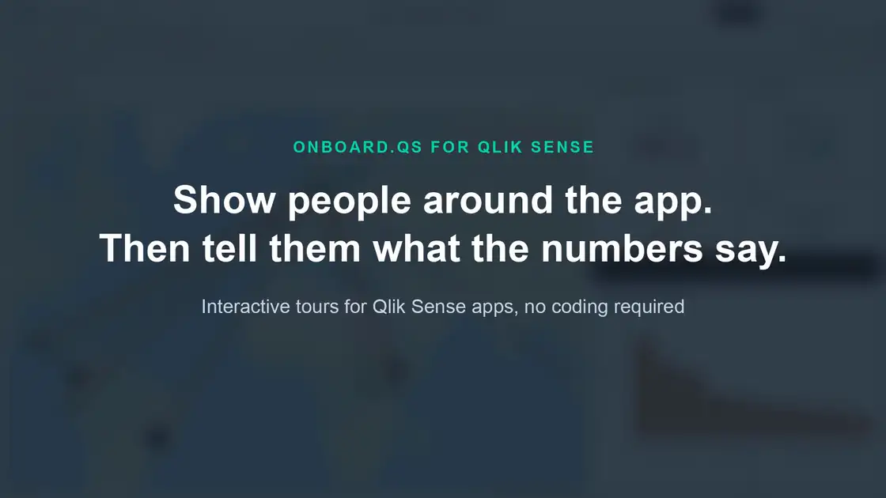
</p>

---

## Features

- **Visual tour builder** — full-screen modal editor with three-panel layout (tours / steps / details). No need to leave the Sense app to configure tours.
- **Multiple tours per sheet** — define intro tours, advanced walkthroughs, or feature announcements, each with independent settings.
- **Sheet object targeting** — select any object on the current sheet from a dropdown. The extension resolves the correct DOM element at runtime.
- **Custom CSS selector targeting** — target any DOM element (toolbar buttons, header items, other extensions) with a raw CSS selector.
- **Markdown descriptions** — step descriptions support Markdown: **bold**, _italic_, [links](url), , lists, blockquotes, inline code, and more.
- **Auto-start with show-once** — tours can launch automatically when the sheet loads and remember whether the user has already seen them.
- **Theme presets & color pickers** — choose from four built-in presets (Default, The Lean Green Machine, Corporate Blue, Corporate Gold) or override every color individually. Font sizes, border radii, font weight, and font family are all configurable.
- **Configurable appearance** — button label, style (primary/secondary/minimal/outlined/pill), horizontal & vertical alignment, progress indicator, keyboard navigation, overlay colour, stage padding/radius, popover button text.
- **Hide hover & context menus** — per-object toggles to hide the Qlik Sense hover menu (three-dot / expand) and right-click context menu, overriding app-level settings.
- **Toolbar button** — optionally inject a "Start Tour" button into the Qlik Sense app toolbar (top-right area). Coexists with [HelpButton.qs](https://github.com/ptarmiganlabs/help-button.qs) without visual overlap. The in-sheet widget can be hidden when the toolbar button is the only trigger.
- **Tour import / export** — export all tours (plus theme and widget settings) to a JSON file, and import them back with three merge modes. Great for sharing tours across apps or backing up configurations.
- **Qlik property panel integration** — everything is also accessible from the standard Qlik Sense property panel in edit mode (tours, steps, settings).
- **Lightweight** — small footprint with only two runtime dependencies: [driver.js](https://driverjs.com/) (~5 KB gzip) for tour rendering and [DOMPurify](https://github.com/cure53/DOMPurify) (~7 KB gzip) for HTML sanitisation.

|                                                                                                                                                                                                                                                    |                                                                                                                                                                                                                                              |
| -------------------------------------------------------------------------------------------------------------------------------------------------------------------------------------------------------------------------------------------------- | -------------------------------------------------------------------------------------------------------------------------------------------------------------------------------------------------------------------------------------------- |
| 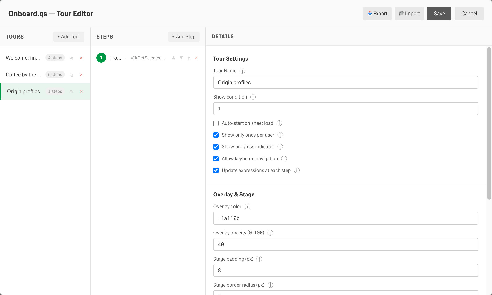 | 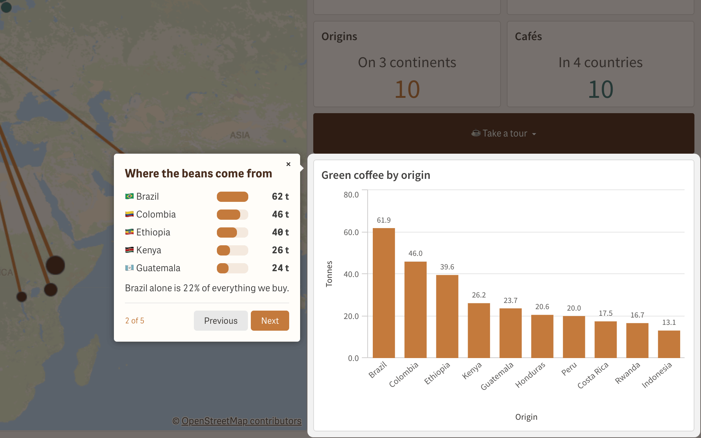 |
| _Tour editor — build tours without leaving the app_                                                                                                                                                                                                | _A tour step on a chart, its figures worked out by Qlik expressions_                                                                                                                                                                         |

---

## Getting Started

### Prerequisites

- **Qlik Sense Cloud**, or
- **Qlik Sense Enterprise on Windows** (client-managed) — November 2025 or later. May work on older versions but not tested - your mileage may vary.

### Download

1. Go to [**Releases**](https://github.com/ptarmiganlabs/onboard.qs/releases) and download the latest release ZIP file (e.g. `onboard-qs-v1.3.0.zip`).
2. Extract the downloaded ZIP file. Inside you will find:
    - `readme.txt` — brief release notes
    - `LICENSE` — the MIT license
    - **`onboard-qs.zip`** — **this is the actual extension file** that you upload to Qlik Sense

> **Note:** The downloaded file is an outer ZIP that wraps the deployable extension ZIP. You need to extract the outer ZIP first, then use the inner `onboard-qs.zip` for installation.

### Install in Qlik Sense

**Qlik Cloud:**

1. Open the **Management Console** → Extensions.
2. Click **Add**, upload `onboard-qs.zip` (the inner ZIP from the release package).
3. Open any app, enter edit mode, and drag **Onboard.qs** from the custom objects panel onto a sheet.

**Client-managed (QSEoW):**

1. Open the **Qlik Management Console (QMC)** → Extensions.
2. Click **Import**, select `onboard-qs.zip` (the inner ZIP from the release package).
3. Open any app in the Sense hub, enter edit mode, and drag the **Onboard.qs** extension from the custom objects panel onto a sheet.

### Create Your First Tour

1. With the extension on a sheet, click **Edit Tours** on the object, or **Open tour editor** at the top of the property panel's **Tours** section. The panel button also works when the object is too small to show its own.
2. Click **+ Add Tour**, give it a name.
3. Click **+ Add Step**, select a target object from the dropdown (or switch to **Custom CSS Selector** for non-object elements).
4. Enter a title and description (Markdown supported).
5. Click **Save**. Switch to analysis mode and click **Start Tour**.

The numbers in the pictures match the steps. Step 1 is in edit mode:

<p align="center">
  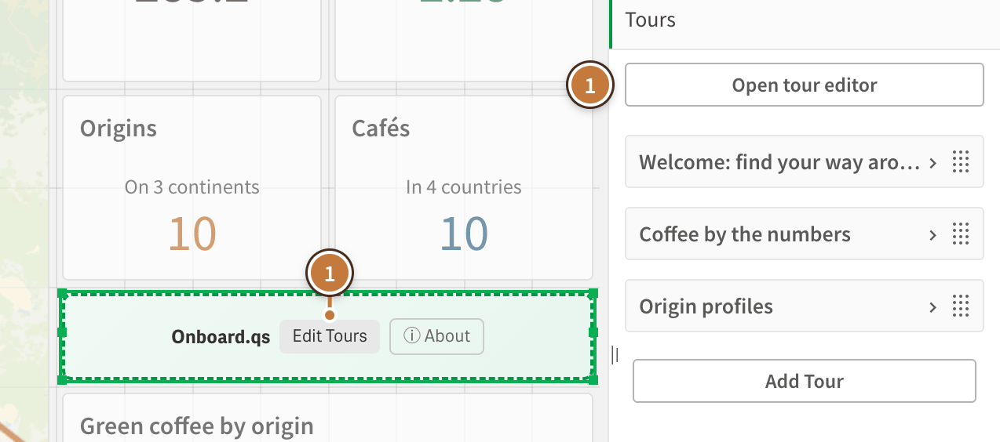
</p>

Steps 2 to 5 are in the tour editor:

<p align="center">
  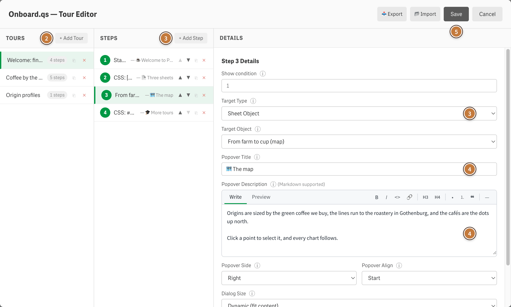
</p>

---

## Platform Support

| Platform                                          | Status    |
| ------------------------------------------------- | --------- |
| Qlik Sense Cloud                                  | Supported |
| Qlik Sense Enterprise on Windows (client-managed) | Supported |

Platform detection is automatic — the extension identifies the environment and adapts accordingly.

---

## Toolbar Coexistence with HelpButton.qs

Onboard.qs is designed to work alongside [HelpButton.qs](https://github.com/ptarmiganlabs/help-button.qs) when both extensions inject buttons into the Qlik Sense app toolbar.

### Button ordering

When both extensions are present on a sheet:

1. **HelpButton.qs** always occupies the **leftmost** position (inserted as `firstChild` of the toolbar anchor).
2. **Onboard.qs** detects the HelpButton container (`#hbqs-container`) and automatically positions its "Start Tour" button **immediately after** the Help button.
3. If HelpButton.qs is **not** present, Onboard.qs takes the leftmost position instead.

This ordering is stable regardless of which extension was added to the sheet first — HelpButton.qs always takes `firstChild` and Onboard.qs always checks for it before deciding where to insert.

### Multiple instances on the same sheet

It is valid to place several Onboard.qs extension objects on the same sheet (e.g. different objects defining different tours). All visible tours are **merged** into a single toolbar button / dropdown. Duplicate tours (the same tour ID, or the same name for a tour without an ID) are shown only once. When an object is removed or its "Show toolbar button" toggle is turned off, its tours are unregistered and the button rebuilds from the remaining objects.

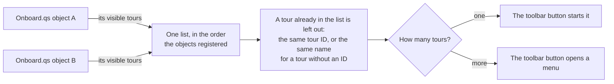

Only objects with **Show toolbar button** on take part. The button's text and colours come from the first object in the list.

---

## Configuration Reference

### Widget Appearance

| Property             | Type     | Default      | Description                                                                                                                             |
| -------------------- | -------- | ------------ | --------------------------------------------------------------------------------------------------------------------------------------- |
| Show start button    | Boolean  | `true`       | Display a "Start Tour" button in analysis mode                                                                                          |
| Button text          | String   | `Start Tour` | Label on the start button (expression-enabled)                                                                                          |
| Button style         | Dropdown | `Primary`    | `Primary`, `Secondary`, `Minimal`, `Outlined`, `Pill`                                                                                   |
| Horizontal alignment | Dropdown | `Center`     | `Left`, `Center`, `Right`                                                                                                               |
| Vertical alignment   | Dropdown | `Center`     | `Top`, `Center`, `Bottom`                                                                                                               |
| Button width (%)     | String   | Auto         | Width of the button as a percentage (1–100) of the extension object. Leave empty for auto (content-based) sizing. (expression-enabled)  |
| Button height (%)    | String   | Auto         | Height of the button as a percentage (1–100) of the extension object. Leave empty for auto (content-based) sizing. (expression-enabled) |
| Fill entire widget   | Boolean  | `false`      | Expand the button to cover the entire extension object area edge-to-edge, removing all internal spacing and border radius               |
| Hide hover menu      | Boolean  | `false`      | Hide the object hover menu (three-dot menu and expand button). Overrides the app-level setting                                          |
| Hide context menu    | Boolean  | `false`      | Hide the right-click context menu on this extension object. Overrides the app-level setting                                             |
| Show toolbar button  | Boolean  | `false`      | Inject a "Start Tour" button into the Qlik Sense app toolbar (top-right area)                                                           |
| Toolbar button text  | String   | `Start Tour` | Label on the toolbar button (expression-enabled). Only visible when toolbar button is enabled                                           |
| Hide sheet widget    | Boolean  | `false`      | Completely hide the extension object on the sheet in analysis mode. Only visible when toolbar button is enabled                         |

> **Note on Button Sizing**: By default, the button sizes itself to its contents. You can use **Button width (%)** and **Button height (%)** to set a relative size within the available space. If you want the button to completely fill the Qlik Sense object area (edge-to-edge), enable **Fill entire widget**. When "Fill" is enabled, the alignment and width/height percentage properties are ignored.

### Theme & Styling

| Property              | Type          | Default                  | Description                                                             |
| --------------------- | ------------- | ------------------------ | ----------------------------------------------------------------------- |
| Theme preset          | Dropdown      | `The Lean Green Machine` | `Default`, `The Lean Green Machine`, `Corporate Blue`, `Corporate Gold` |
| Font family           | String        | (from preset)            | CSS font-family value (expression-enabled)                              |
| Button colors         | Color pickers | (from preset)            | Background, text, hover background, border color                        |
| Button font size      | String (px)   | (from preset)            | Font size in pixels (expression-enabled)                                |
| Button border radius  | String (px)   | (from preset)            | Border radius in pixels (expression-enabled)                            |
| Button font weight    | Dropdown      | (from preset)            | `Normal (400)`, `Medium (500)`, `Semibold (600)`, `Bold (700)`          |
| Popover colors        | Color pickers | (from preset)            | Background, text, title, button bg/text/hover, progress bar             |
| Popover font size     | String (px)   | (from preset)            | Font size in pixels (expression-enabled)                                |
| Popover border radius | String (px)   | (from preset)            | Border radius in pixels (expression-enabled)                            |
| Menu colors           | Color pickers | (from preset)            | Background, text, hover background for the multi-tour dropdown menu     |

All color properties use the native Qlik color-picker component. When you switch presets, all pickers update to the preset's defaults. Individual overrides take precedence over the preset.

### Tour Settings

| Property                        | Type    | Default    | Description                                                                                                                                                                                                                                                                    |
| ------------------------------- | ------- | ---------- | ------------------------------------------------------------------------------------------------------------------------------------------------------------------------------------------------------------------------------------------------------------------------------ |
| Tour name                       | String  | `New Tour` | Display name shown in multi-tour dropdown (expression-enabled)                                                                                                                                                                                                                 |
| Show condition                  | String  | —          | Controls visibility of this tour. Supports expressions (1 = show, 0 = hide).                                                                                                                                                                                                   |
| Auto-start                      | Boolean | `false`    | Start the tour automatically on sheet load                                                                                                                                                                                                                                     |
| Show only once                  | Boolean | `true`     | Skip auto-start if user has already seen this tour version (uses `localStorage`)                                                                                                                                                                                               |
| Tour version                    | Integer | `1`        | Increment to reset the "seen" flag for all users (expression-enabled)                                                                                                                                                                                                          |
| Show progress                   | Boolean | `true`     | Display an "X of Y" progress counter in popovers; its wording is set by Progress text                                                                                                                                                                                          |
| Allow keyboard                  | Boolean | `true`     | Enable arrow-key / Escape navigation                                                                                                                                                                                                                                           |
| Update expressions at each step | Boolean | `false`    | Evaluate step titles, descriptions, show conditions and the button and progress texts again during the tour, so they follow selections made during it: in the step on screen, and at each move to another step. When off, expressions are evaluated once, when the tour starts |

#### When a tour starts by itself

A tour with **Auto-start** on starts half a second after its sheet has loaded in analysis mode, unless one of these stops it:

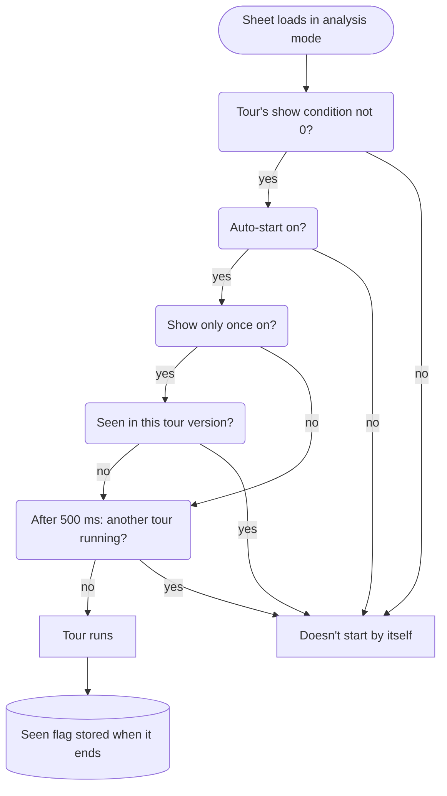

The seen flag is stored when the tour ends, by **Done**, the close button, Esc, or leaving the sheet. It is kept in the browser's `localStorage`, under `onboard-qs:<appId>:<sheetId>:<tourId>:v<version>`. Raising **Tour version** gives the tour a new key, so it starts by itself again for everyone. A tour started from the button is marked as seen when it ends, too. A tour starts by itself at most once per visit to the sheet. When more than one tour on a sheet would, the first to start runs and the others don't start on that visit.

#### Update expressions at each step

With **Update expressions at each step** on, a step's title and description follow the selections made during the tour. In the coffee demo app, the tour _Origin profiles_ is one step on the map. Click an origin, and the step becomes that origin's profile:

|                                                                                                                                                                                                                      |                                                                                                                                                                                                                                            |
| -------------------------------------------------------------------------------------------------------------------------------------------------------------------------------------------------------------------- | ------------------------------------------------------------------------------------------------------------------------------------------------------------------------------------------------------------------------------------------ |
| 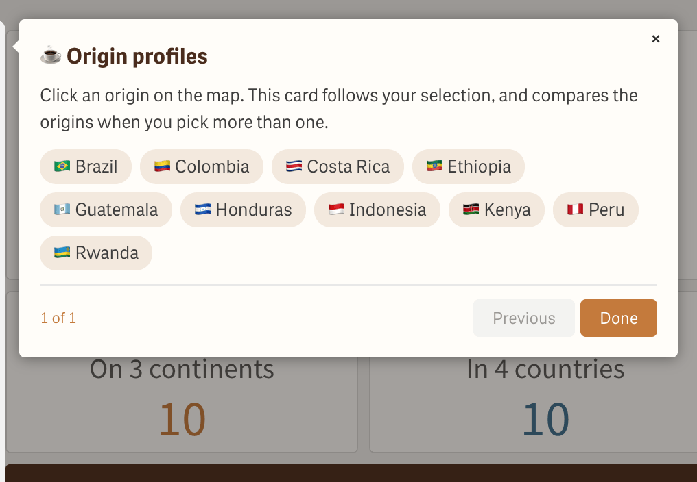 | 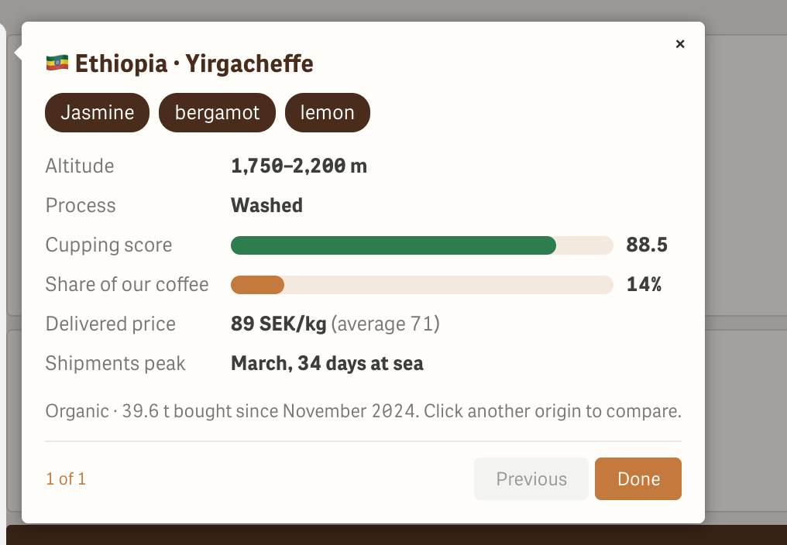 |
| _Nothing selected_                                                                                                                                                                                                   | _After clicking Ethiopia on the map_                                                                                                                                                                                                       |

When the expressions are evaluated, with the setting off and on:

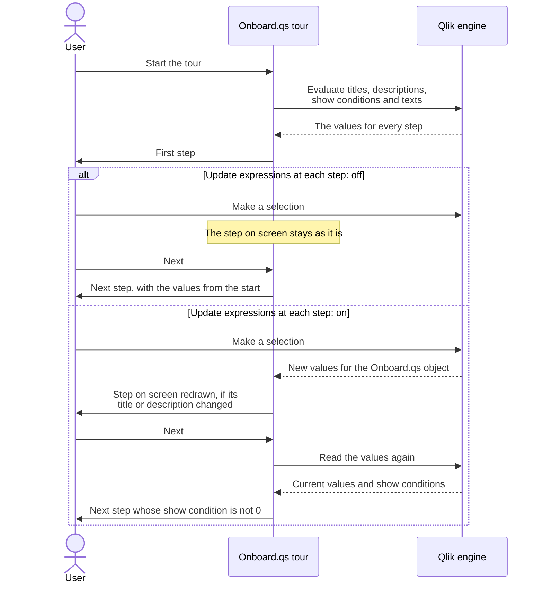

Some settings stay as they were when the tour started, with the setting on too: the tour's own show condition, the overlay and stage settings, and whether keyboard navigation and the progress counter are on.

### Step Settings

| Property            | Type              | Default        | Description                                                                               |
| ------------------- | ----------------- | -------------- | ----------------------------------------------------------------------------------------- |
| Show condition      | String            | —              | Controls visibility of this step. Supports expressions (1 = show, 0 = hide).              |
| Target type         | Dropdown          | `Sheet Object` | `Sheet Object`, `Custom CSS Selector`, or `Standalone Dialog (no target)`                 |
| Target object       | Dropdown          | —              | Select a visualisation from the current sheet (shown when Target type = Sheet Object)     |
| CSS selector        | String            | —              | Any valid CSS selector (expression-enabled); shown when Target type = Custom CSS Selector |
| Popover title       | String            | —              | Heading text (expression-enabled)                                                         |
| Popover description | String (Markdown) | —              | Body text with Markdown support (expression-enabled)                                      |
| Popover side        | Dropdown          | `Bottom`       | `Top`, `Bottom`, `Left`, `Right`                                                          |
| Popover align       | Dropdown          | `Center`       | `Start`, `Center`, `End`                                                                  |
| Disable interaction | Boolean           | `true`         | Prevent clicks on the highlighted element during this step                                |

### Step Dialog Size

Every step type has a dialog size: standalone dialogs and popovers attached to an object or CSS selector alike.

| Size        | Dimensions                           |
| ----------- | ------------------------------------ |
| Dynamic     | Fit content                          |
| Small       | 320 × 220 px                         |
| Medium      | 480 × 320 px (default for new steps) |
| Large       | 640 × 420 px                         |
| Extra Large | 800 × 520 px                         |
| Custom      | User-specified width × height        |

A step saved without a size renders as **Medium** if it is a standalone dialog and **Dynamic** if it is attached to a target, as it did before sizes applied to attached steps.

The height is a minimum. A dialog never grows bigger than the browser window, though: in a narrower window it gets narrower, and when its content doesn't fit, the description scrolls and the title and buttons stay in view.

When **Custom** is selected, two additional fields appear: **Custom width (px)** (default `500`) and **Custom height (px)** (default `350`). Both take an expression.

### Tour Overlay & Navigation

The following per-tour properties are configured in both the **property panel** and the **tour editor modal**. They control the driver.js overlay, the navigation buttons and the progress counter. Each of them takes an expression in both places, so one tour can switch language with a variable, or change its overlay with the selections:

| Property             | Type    | Default                    | Description                                                                                                                                              |
| -------------------- | ------- | -------------------------- | -------------------------------------------------------------------------------------------------------------------------------------------------------- |
| Overlay color        | String  | `rgba(0, 0, 0, 0.6)`       | Background color behind the highlighted area (expression-enabled)                                                                                        |
| Overlay opacity      | Integer | `60`                       | Opacity percentage, 0–100 (expression-enabled)                                                                                                           |
| Stage padding        | Integer | `8`                        | Padding around the highlighted element, in px (expression-enabled)                                                                                       |
| Stage border radius  | Integer | `5`                        | Border radius of the highlight cutout, in px (expression-enabled)                                                                                        |
| Next button text     | String  | `Next`                     | Label for the “Next” navigation button (expression-enabled)                                                                                              |
| Previous button text | String  | `Previous`                 | Label for the “Previous” navigation button (expression-enabled)                                                                                          |
| Done button text     | String  | `Done`                     | Label for the final step's navigation button (expression-enabled)                                                                                        |
| Progress text        | String  | `{{current}} of {{total}}` | Progress counter in each popover. `{{current}}` becomes the step number and `{{total}}` the number of steps; each is filled in once (expression-enabled) |

<p align="center">
  
</p>

1. **Overlay color** and **Overlay opacity**: the shade over everything but the highlighted object
2. **Stage padding**: the space between the object and the edge of the highlight
3. **Stage border radius**: how round the highlight's corners are
4. **Progress text**: the step counter, here `{{current}} of {{total}}`
5. **Previous button text**, **Next button text** and, on the last step, **Done button text**

---

## Markdown & HTML in Step Descriptions

Step descriptions support **Markdown**, **raw HTML**, and **a mix of both**. The text you enter is processed by a built-in mini Markdown-to-HTML converter ([src/util/markdown.js](src/util/markdown.js)) before being injected into the driver.js popover. Since driver.js renders description content as HTML, raw HTML tags pass through and render natively.

|                                                                                                                                                                                                                 |                                                                                                                                                                                       |
| --------------------------------------------------------------------------------------------------------------------------------------------------------------------------------------------------------------- | ------------------------------------------------------------------------------------------------------------------------------------------------------------------------------------- |
| 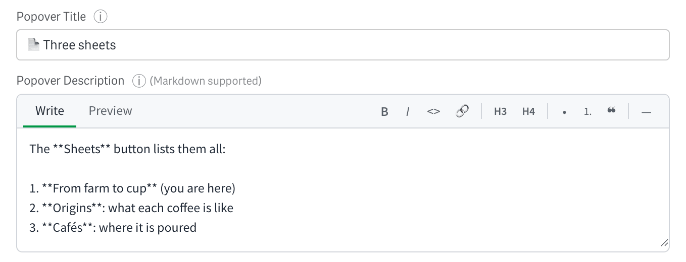 | 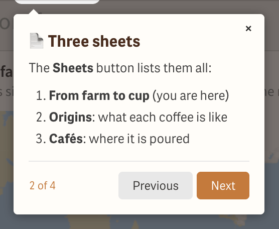 |
| _A description as typed in the tour editor..._                                                                                                                                                                  | _...and the step it gives_                                                                                                                                                            |

### Supported Markdown Syntax

#### Text Formatting

```markdown
**Bold text** or **also bold**
_Italic text_ or _also italic_
**Bold and _nested italic_ together**
`inline code`
```

Renders as: **Bold text**, _Italic text_, `inline code`.

As in [CommonMark](https://spec.commonmark.org/0.31.2/#emphasis-and-strong-emphasis), a `*` or `_` only starts or ends formatting when it touches the text it formats. So `price * quantity * 12` stays as it is, and so does the `_` in `snake_case`. Code in backticks shows exactly as typed, HTML tags included.

#### Links

```markdown
[Visit Qlik Community](https://community.qlik.com)
[Open documentation](https://ptarmiganlabs.com/docs)
```

Links open in a new tab (`target="_blank"`) automatically.

#### Images

```markdown


```

Images are automatically constrained to `max-width: 100%` so they fit within the popover.

##### Embedded Images (Base64)

For self-contained apps with no external image hosting, embed images directly as base64 data URIs:

```markdown

```

To create a base64 data URI: open an image in a browser, use browser DevTools console:

```js
// Drag image to browser tab, then in console:
document.querySelector('img').src; // Copy the data:image/... string
```

Or convert from the command line:

```bash
base64 -i screenshot.png | pbcopy   # macOS — copies to clipboard
```

Then paste as: ``

> **Note:** Base64 images are stored inside the Qlik object properties (in the `.qvf` file). A 100 KB image becomes ~133 KB of text. This is fine for small/medium images but avoid very large files to keep the app responsive.

#### Lists

```markdown
- First item
- Second item
- Third item

1. Step one
2. Step two
3. Step three
```

An ordered list starts at its first item's number, so `2024.` and `2025.` render as 2024. and 2025.

#### Blockquotes

```markdown
> This filter bar controls all charts on the sheet.
> Select a region to drill down.
```

Blockquotes render with a green accent border to provide visual emphasis.

#### Headings

```markdown
### Section Heading (h3)

#### Sub-heading (h4)

##### Smaller heading (h5)

###### Smallest heading (h6)
```

> h1 and h2 are intentionally omitted — they're too large for popover content.

#### Horizontal Rules

```markdown
---
```

Renders as a thin separator line, useful for dividing sections within a step description.

#### Paragraphs and Line Breaks

- **Blank line** → new paragraph (with spacing)
- **Single newline** → `<br>` line break (no spacing), except before a line that starts with an HTML tag, and inside [HTML blocks](#raw-html)

```markdown
First paragraph with some context.

Second paragraph after a blank line.
This line is a <br> continuation of the second paragraph.
```

### Raw HTML

Since the converter preserves HTML tags, you can use **any HTML** directly in description fields:

```html
<span style="color: red; font-weight: bold;">Important!</span>

<div style="background: #f0f8ff; padding: 8px; border-radius: 4px;">Custom styled callout box</div>


<table>
    <tr>
        <td><b>KPI</b></td>
        <td><b>Target</b></td>
    </tr>
    <tr>
        <td>Revenue</td>
        <td>$1.2M</td>
    </tr>
</table>

<a href="https://help.qlik.com" target="_blank">Qlik Help →</a>

<video width="300" controls>
    <source src="/content/Default/demo.mp4" type="video/mp4" />
</video>
```

A line that starts with a block-level tag, such as `<div>`, `<table>` or `<p>`, starts an **HTML block**. So does a line that holds nothing but one tag, such as `<svg …>` or ``, when a blank line comes before it. Straight after a line of text, such a line belongs to that text's paragraph, and so does what follows it. The block runs to the next blank line. A `<pre>`, `<script>`, `<style>` or `<textarea>` block, and an `<!-- … -->` comment, run to their end instead. Inside an HTML block the converter adds no paragraphs and no line breaks, so the HTML can be indented and spread over as many lines as you like, as above. This is how [CommonMark](https://spec.commonmark.org/0.31.2/#html-blocks) treats HTML. Bold, italics, links and code still work in the text between the tags, within one element: bold can't start in one table cell and end in the next. Markdown never changes anything inside a tag, such as an image URL or a `style` attribute, or anything inside an `<svg>` or `<math>` element.

A Markdown list, heading, quote or rule inside an HTML element needs a blank line before and after it, or it shows as plain text:

```markdown
<div style="background: #f0f8ff; padding: 8px;">

- First point
- Second point

</div>
```

### Mixing Markdown and HTML

You can freely combine both in the same description:

```markdown
**Welcome to the Sales Dashboard!**

This chart shows revenue by region. Use the filters below to drill down.


Key things to note:

- Click any bar to **make a selection**
- Use <kbd>Ctrl+Z</kbd> to undo
- See the [user guide](https://example.com/guide) for details

> <span style="color: #e67e22;">⚠️ Tip:</span> Hover over a bar to see the exact value.
```

### What Gets Escaped

The parser escapes `&` when it isn't part of an HTML entity, in your own HTML's attributes too (but not in a `<style>`, a `<script>` or a comment). It escapes `<` when it doesn't start an HTML tag (`<name …>`, `</name>`) or comment (`<!-- … -->`). This means:

| Input                   | Result                                          |
| ----------------------- | ----------------------------------------------- |
| `<strong>Bold</strong>` | Preserved as HTML → **Bold**                    |
| ``     | Preserved as HTML → rendered image              |
| `5 < 10`                | Escaped to `5 &lt; 10` → displays as text       |
| `Sales<budget in Q3`    | Escaped to `Sales&lt;budget` → displays as text |
| `AT&T`                  | Escaped to `AT&amp;T` → displays as text        |
| `&copy;`                | Preserved → ©                                   |

As in CommonMark, a `<` followed by a name and, later, a `>` is a tag, so `x<y and y>z` loses `<y and y>`. Write `x < y` with spaces, or `x &lt; y`, when text like that comes from a formula.

### Complete Example

A real-world step description combining multiple features:

```markdown
### Revenue by Region

This bar chart shows **quarterly revenue** broken down by sales region.


**How to interact:**

1. Click a bar to select that region
2. All other charts on this sheet will filter accordingly
3. Use _Ctrl+Click_ to select multiple regions

> 💡 **Pro tip:** Right-click any bar for additional options
> including "Exclude" and "Select possible".

---

<small style="color: #888;">
  Data source: SAP BW · Updated daily at 06:00 UTC
</small>
```

### Embedding Videos

You can embed videos in step descriptions using raw HTML. Use the **Large** or **X-Large** dialog size preset (or a **Custom** size) for steps that contain video embeds — videos need horizontal space to look good.

#### Self-hosted / Content server (`<video>` tag)

On **Qlik Sense Enterprise on Windows (client-managed)**, files uploaded via the QMC content library are served at `/content/Default/<filename>`:

```html
<video width="400" controls>
    <source src="/content/Default/demo.mp4" type="video/mp4" />
</video>
```

On **Qlik Cloud** or any platform, use a full HTTPS URL:

```html
<video width="400" controls>
    <source src="https://cdn.example.com/videos/tour-intro.mp4" type="video/mp4" />
</video>
```

#### YouTube / Vimeo (`<iframe>` embed)

```html
<iframe width="400" height="225" src="https://www.youtube.com/embed/VIDEO_ID" allowfullscreen>
</iframe>
```

> **Note:** `<iframe>` embeds are subject to the browser Content Security Policy (CSP).
> On Qlik Cloud, the tenant's CSP may block external iframe sources.
> On client-managed Qlik Sense, admins control CSP via the proxy configuration.

#### Fallback: clickable thumbnail

If CSP blocks iframes, a clickable thumbnail that opens the video in a new tab is a universally compatible alternative:

```html
<a href="https://www.youtube.com/watch?v=VIDEO_ID" target="_blank">
    
    <br /><small>▶ Click to watch the tutorial</small>
</a>
```

---

## Tour Import & Export

Onboard.qs lets you selectively export tours — optionally including theme and widget settings — to a JSON file, and import them back into the same or a different Qlik app. This is useful for:

- **Sharing** tour configurations across apps or tenants
- **Backing up** tours before making major changes
- **Migrating** from development to production environments

### How It Works

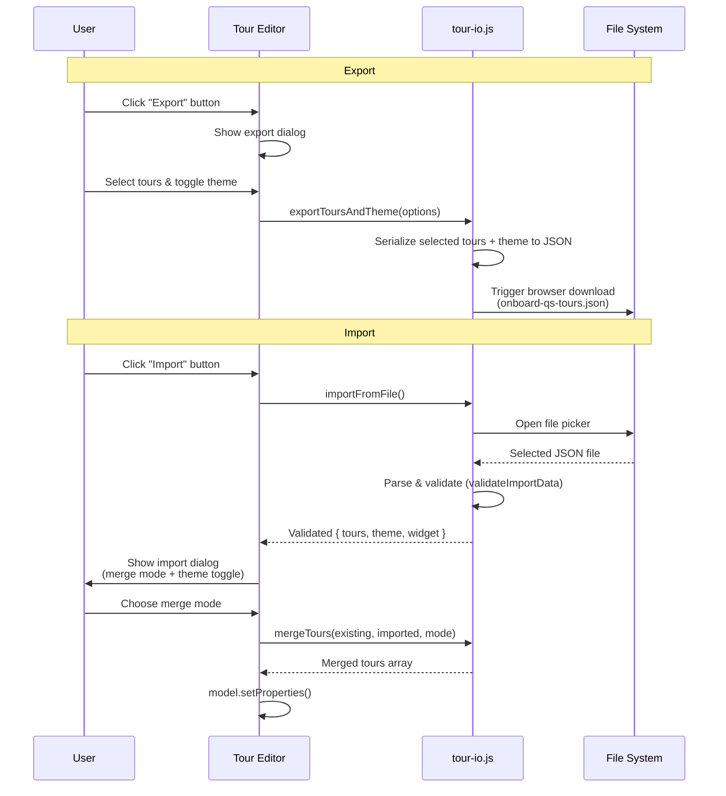

### Exporting Tours

Clicking the **Export** button in the Tour Editor opens a dialog where you can specific which tours you want to save. Instead of always exporting all tours, you can select only the ones relevant to your needs.

If your dashboard includes customized theme or widget styling, an **Include theme & widget settings** checkbox will appear. This allows you to bundle styling with your tours, making it easier to migrate visual configurations between apps perfectly alongside the content.

<p align="center">
  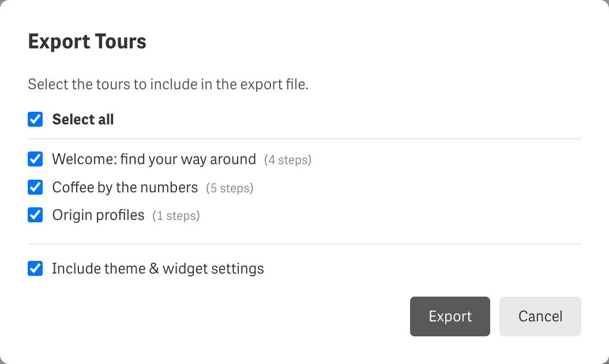
</p>

### Import Merge Modes

| Mode             | Behaviour                                                                                         |
| ---------------- | ------------------------------------------------------------------------------------------------- |
| Replace Matching | Replace tours whose name matches an imported tour; keep all other existing tours; append new ones |
| Replace All      | Delete all existing tours and replace with the imported set                                       |
| Add to Existing  | Append all imported tours as new entries (duplicates are allowed)                                 |

During import, an optional **Import theme settings** toggle lets you also overwrite the current theme/widget configuration with the values from the import file.

---

## Standalone Dialog Steps

Not every tour step needs to point at a specific element. **Standalone Dialog** steps display a centered popover with no highlighted target — perfect for:

- **Welcome / intro messages** at the start of a tour
- **Summary / conclusion** steps at the end
- **General explanations** about the sheet, app, or data model
- **Instructions** that don't relate to a single object

### How to Create a Standalone Step

1. In the tour editor, click **+ Add Step**.
2. Set **Target Type** to **Standalone Dialog (no target)**.
3. Enter a title and description (Markdown/HTML supported).
4. The step will appear as a centered modal during the tour.

<p align="center">
  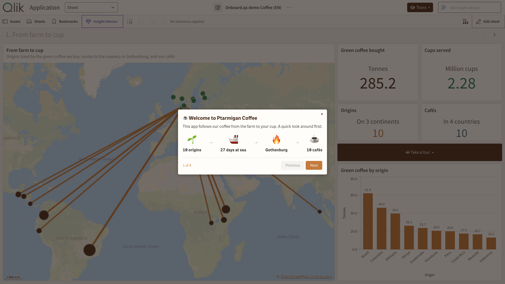
</p>

_The coffee demo app's welcome tour starts by itself on a first visit, with a standalone dialog. The figures in its strip are Qlik expressions._

### Example Tour Structure

A typical onboarding tour mixing standalone and targeted steps:

| #   | Target Type         | Title                       | Purpose                               |
| --- | ------------------- | --------------------------- | ------------------------------------- |
| 1   | Standalone Dialog   | Welcome to Sales Analytics! | Intro — explain what the sheet is for |
| 2   | Sheet Object        | Revenue by Region           | Highlight the main KPI chart          |
| 3   | Sheet Object        | Filter Bar                  | Show how to filter data               |
| 4   | Custom CSS Selector | Help Button                 | Point out where to get help           |
| 5   | Standalone Dialog   | You're all set!             | Summary — encourage exploration       |

---

## Targeting Non-Object Elements

The **Custom CSS Selector** target type lets you highlight any DOM element on the page, not just Qlik sheet objects. Examples:

| Target                                 | CSS Selector                                               |
| -------------------------------------- | ---------------------------------------------------------- |
| Help button (Ptarmigan Labs extension) | `#helpbutton-qs` or inspect the DOM for the exact selector |
| Sheets button (client-managed)         | `[data-tid="assets-button-sheets"]`                        |
| Bookmarks button (client-managed)      | `[data-tid="assets-button-bookmarks"]`                     |
| Sheet title                            | `.sheet-title-container`                                   |
| Any element by ID                      | `#my-custom-id`                                            |

<p align="center">
  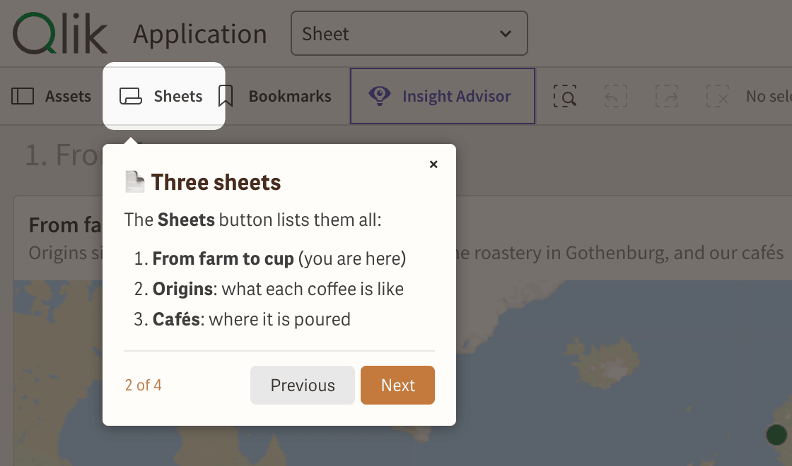
</p>

_A step on Sense's own Sheets button, with the selector `[data-tid="assets-button-sheets"]`._

To find the right selector: right-click the element in the browser → **Inspect** → look for an `id`, `data-tid`, `data-testid` or `tid` attribute. These are the same in every UI language. Avoid `title` attributes, which are translated, and generated classes such as `css-1x2y3z`, which can change with any Sense release. The [demo app tutorial](docs/DEMO-APP-TUTORIAL.md#techniques-worth-copying) shows the selectors its welcome tour uses for Sense's toolbar.

A step whose selector matches nothing is shown as a dialog in the middle of the screen. So is a step whose selector isn't valid CSS: a typo, a selector that ends in `>`, or an ID that starts with a digit, such as `#2024` from a formula. The property panel and the tour editor warn about a selector they can't parse. A selector built by a formula can only be checked when the tour runs.

How a step finds what it points at, for each target type:

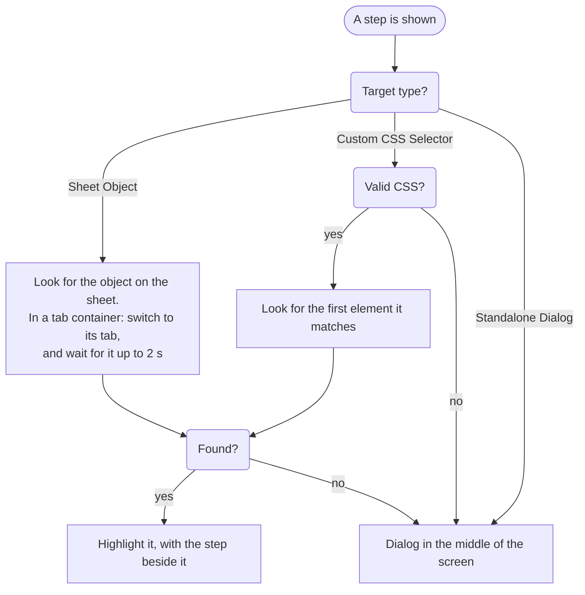

A step with no target at all, a sheet object step with no object chosen or a CSS step with an empty selector, is left out of the tour.

---

## Documentation & Resources

- [Release blog post](https://ptarmiganlabs.com/interactive-onboarding-tours-for-qlik-sense/) — overview and demo of Onboard.qs
- [Tutorial](docs/DEMO-APP-TUTORIAL.md) — learn Onboard.qs from the demo apps, one sheet at a time
- [CHANGELOG](CHANGELOG.md) — version history and release notes

### For Developers

If you want to build the extension from source, contribute, or understand the internals, see the [Development Guide](docs/DEVELOPMENT.md). It covers:

- Building from source (prerequisites, npm scripts)
- Project structure and architecture
- Platform detection internals
- Links to detailed design docs

---

## License

MIT — see [LICENSE](LICENSE).

---

## Author

Ptarmigan Labs - [ptarmiganlabs.com](https://ptarmiganlabs.com)
