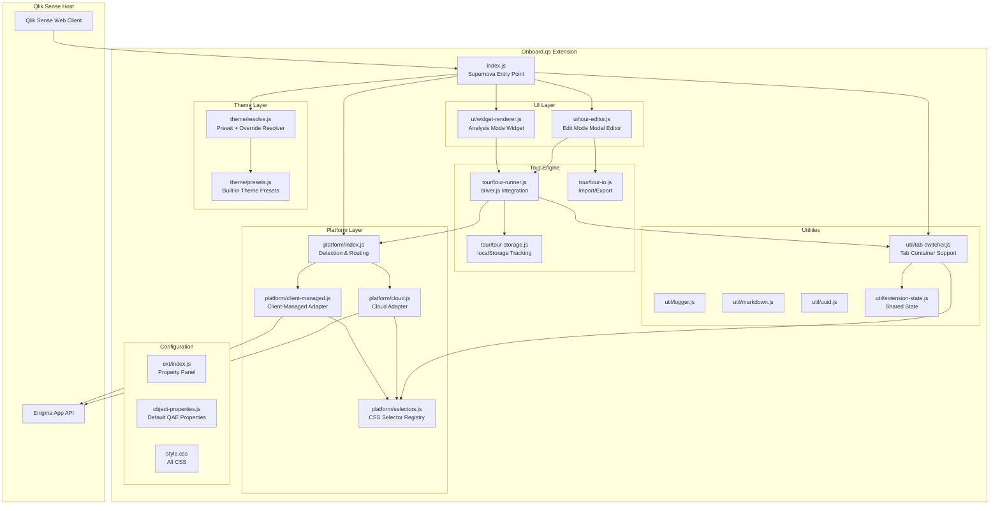
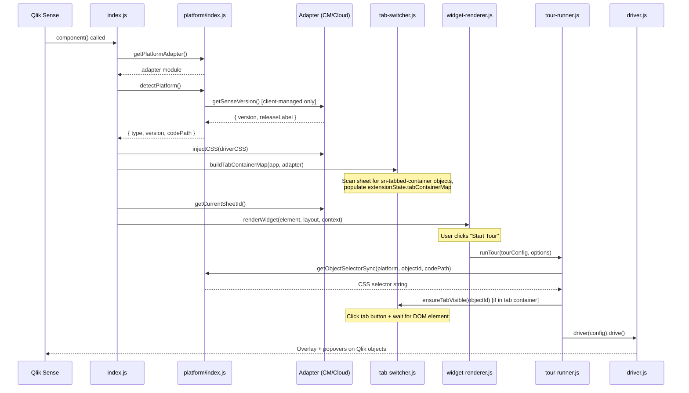
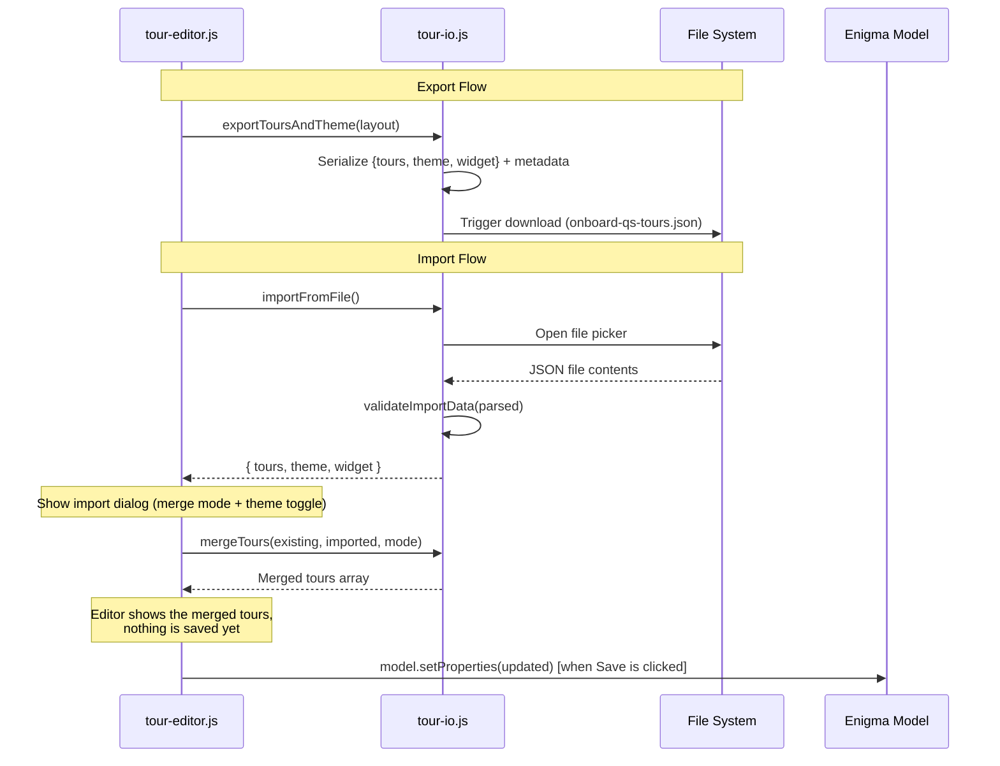
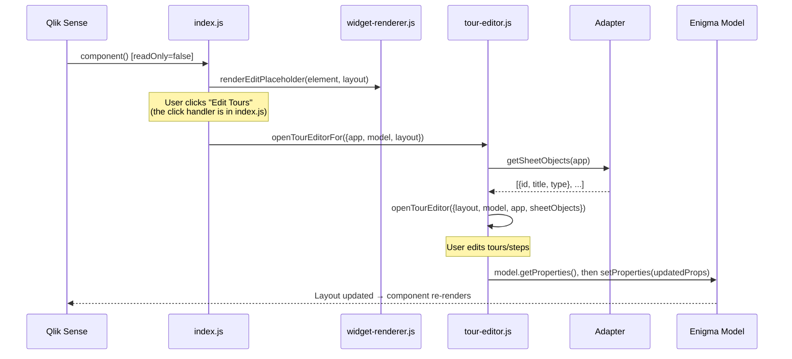
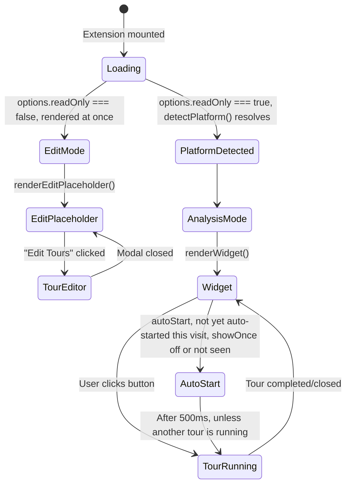

# Onboard.qs — Architecture Overview

This document describes the high-level architecture of the **Onboard.qs** Qlik Sense extension.

## What it does

Onboard.qs adds interactive, step-by-step onboarding tours to any Qlik Sense app. App developers configure tours in edit mode using a rich modal editor; end-users see a "Start Tour" button (or auto-started tours) in analysis mode. Tours highlight Qlik objects on the sheet with popovers powered by [driver.js](https://driverjs.com/).

## High-level component map



## Module responsibilities

| Module                       | Responsibility                                                                                                                                                                                                                               |
| ---------------------------- | -------------------------------------------------------------------------------------------------------------------------------------------------------------------------------------------------------------------------------------------- |
| `index.js`                   | Nebula/Stardust supernova entry point. Hooks into Qlik lifecycle (`useLayout`, `useApp`, etc.), detects platform once, delegates rendering.                                                                                                  |
| `platform/index.js`          | Detects whether running on Cloud or client-managed (URL-based). Resolves the correct adapter and Sense version.                                                                                                                              |
| `platform/client-managed.js` | Client-managed Qlik Sense adapter: sheet ID detection (URL → Qlik API → DOM), Engine API sheet objects, Sense version detection, version-range-to-code-path mapping.                                                                         |
| `platform/cloud.js`          | Qlik Cloud adapter: standalone implementation (no delegation to client-managed). Same interface, maintained independently.                                                                                                                   |
| `platform/selectors.js`      | Single-source-of-truth CSS selector registry. Maps `(platform, codePath)` → selector functions.                                                                                                                                              |
| `theme/resolve.js`           | Theme resolver. Merges a preset's defaults with per-property overrides from the layout, producing a flat map of CSS custom-property name → value. Also provides `applyThemeToElement()`, `buildPopoverThemeCSS()`, and `injectThemeStyle()`. |
| `theme/presets.js`           | Built-in theme presets (Default, The Lean Green Machine, Corporate Blue, Corporate Gold). Each preset defines all color, size, and font values.                                                                                              |
| `tour/tour-runner.js`        | Transforms tour config into driver.js steps, launches tours, handles highlight preview.                                                                                                                                                      |
| `tour/tour-storage.js`       | localStorage-based tracking of "has user seen this tour version".                                                                                                                                                                            |
| `tour/tour-io.js`            | Tour import/export: serializes tours + theme + widget to JSON, imports with validation, supports three merge modes (Replace Matching, Replace All, Add to Existing).                                                                         |
| `ui/widget-renderer.js`      | Renders the analysis-mode UI: "Start Tour" button, multi-tour dropdown, auto-start logic.                                                                                                                                                    |
| `ui/tour-editor.js`          | Full-screen modal editor for creating/editing tours and steps in edit mode.                                                                                                                                                                  |
| `ext/index.js`               | Qlik property panel definition. Provides a hybrid approach (property panel + modal editor).                                                                                                                                                  |
| `object-properties.js`       | Default QAE properties for new extension instances.                                                                                                                                                                                          |
| `util/logger.js`             | Build-aware logger (`debug` suppressed in production). Exposes `BUILD_TYPE` and `PACKAGE_VERSION`.                                                                                                                                           |
| `util/markdown.js`           | Minimal Markdown-to-HTML converter for tour step descriptions, with raw HTML blocks as in CommonMark.                                                                                                                                        |
| `util/uuid.js`               | UUID v4 generator for tour/step IDs.                                                                                                                                                                                                         |
| `style.css`                  | All CSS: widget, editor, buttons, driver.js theme overrides, Cloud z-index fixes, hover menu hiding.                                                                                                                                         |

## Data flow: analysis mode



## Data flow: tour import/export



## Data flow: edit mode



## Extension lifecycle



Edit mode doesn't wait for platform detection: `index.js` renders the placeholder straight away. When `options.readOnly` isn't set yet, an `/edit` URL counts as edit mode.

The auto-start rule in full: a tour with **Auto-start** on starts by itself at most once per visit to the sheet. With **Show only once** off it does so on every visit, and with it on only until the user has seen the tour's current version. See [When a tour starts by itself](../README.md#when-a-tour-starts-by-itself) in the README, and [Auto-start tours](TOUR-SYSTEM.md#auto-start-tours) for how a visit is tracked.

## File tree

```
src/
├── index.js                  # Supernova entry point
├── object-properties.js      # Default QAE properties
├── style.css                 # All CSS
├── data.js                   # Data targets (empty)
├── meta.json                 # nebula sense metadata
├── ext/
│   ├── index.js              # Property panel definition
│   ├── tours-section.js      # Tours section, target-object dropdown (getObjectList)
│   ├── widget-section.js     # Widget Appearance section
│   ├── theme-section.js      # Theme & Styling section
│   ├── theme-helpers.js      # Color keys and preset helpers for the theme section
│   ├── security-section.js   # Security section (URI allowlist)
│   ├── about-section.js      # About section
│   └── lui-icons.js          # Lui icons for the button icon picker
├── platform/
│   ├── index.js              # Platform detection & routing
│   ├── client-managed.js     # Client-managed adapter
│   ├── cloud.js              # Cloud adapter (standalone)
│   └── selectors.js          # CSS selector registry
├── tour/
│   ├── tour-runner.js        # driver.js integration
│   ├── tour-helpers.js       # startTour(), auto-start and sheet visits
│   ├── tour-storage.js       # localStorage tracking
│   └── tour-io.js            # Tour import/export (JSON, merge modes)
├── theme/
│   ├── resolve.js            # Theme resolver (preset + overrides → CSS vars)
│   └── presets.js            # Built-in theme presets (4)
├── ui/
│   ├── widget-renderer.js    # Analysis mode widget
│   ├── toolbar-injector.js   # Tour button in the Sense toolbar
│   ├── tour-editor.js        # Edit mode modal editor
│   ├── confirm-discard.js    # Unsaved-changes confirmation dialog
│   ├── markdown-editor-dialog.js # Property panel's Markdown editor dialog
│   └── markdown-toolbar.js   # Tabbed Write/Preview Markdown editor
└── util/
    ├── css-selector.js       # Checks for step CSS selectors
    ├── dialog-size.js        # Dialog-size presets for steps
    ├── expressions.js        # Qlik expression values (=expr ↔ qStringExpression)
    ├── extension-state.js    # Shared state (model and app refs, tabContainerMap)
    ├── logger.js             # Build-aware logging
    ├── markdown.js           # Minimal MD→HTML
    ├── markdown-shortcuts.js # Markdown keyboard shortcuts
    ├── sanitize.js           # Lui icon name sanitizer
    ├── tab-switcher.js       # Tab container auto-switching
    ├── uuid.js               # UUID v4 generator
    └── visibility.js         # Show conditions of tours and steps
```
