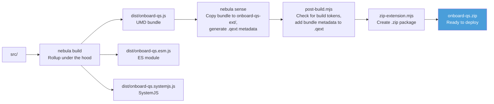
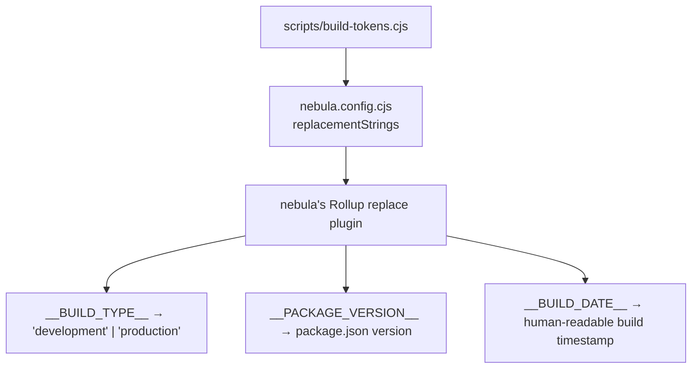
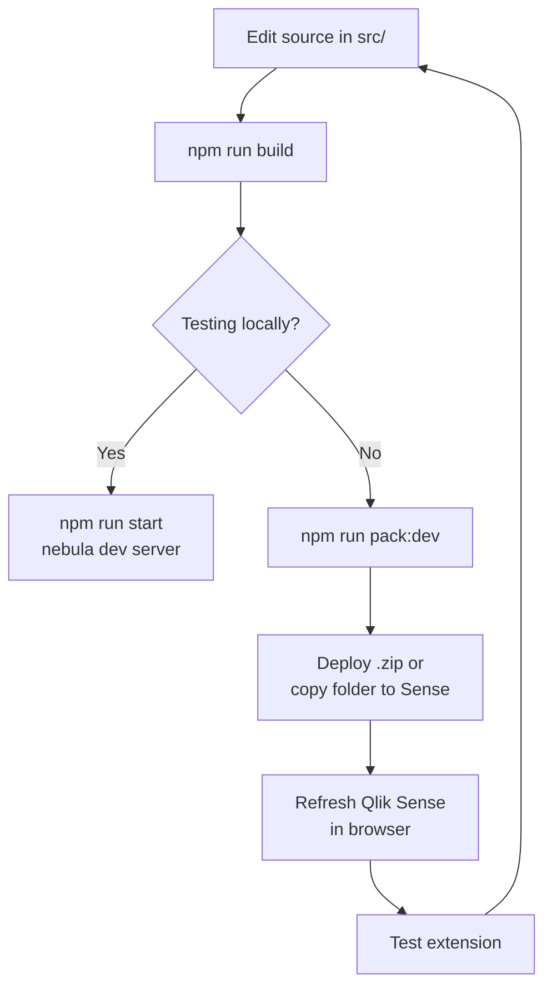
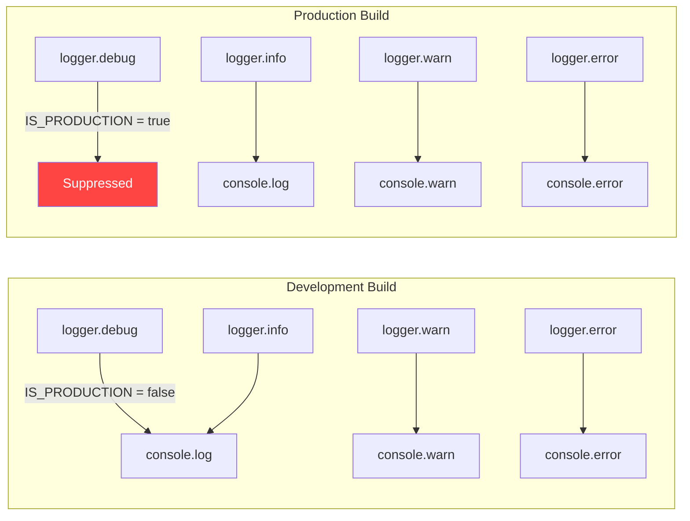

# Build & Deployment

Onboard.qs uses the [nebula.js](https://qlik.dev/toolkits/nebulajs/) build toolchain to produce a Qlik Sense extension package (`.zip`).

## Build toolchain



## npm scripts

| Script                  | Purpose                                                       |
| ----------------------- | ------------------------------------------------------------- |
| `npm run build`         | Development build (unminified, sourcemaps off)                |
| `npm run build:dist`    | Production build (minified)                                   |
| `npm run pack:dev`      | Full pipeline: build → sense → post-build → zip (development) |
| `npm run pack:prod`     | Full pipeline: build → sense → post-build → zip (production)  |
| `npm run start`         | Start nebula dev server for local development                 |
| `npm run lint`          | Run ESLint on `src/` and `scripts/`                           |
| `npm run lint:fix`      | Run ESLint with auto-fix                                      |
| `npm run format`        | Format all files with Prettier                                |
| `npm run format:check`  | Check formatting without modifying files                      |
| `npm run version:major` | Bump major version (no git tag)                               |
| `npm run version:minor` | Bump minor version (no git tag)                               |
| `npm run version:patch` | Bump patch version (no git tag)                               |

## Build configuration

### nebula.config.cjs

`nebula build` reads the `build` section of `nebula.config.cjs` as its command-line options. It never reads a key it does not know, and gives no error or warning for one, so the file can only set options that nebula has: it cannot add a plugin to nebula's Rollup pipeline. Every script that runs `nebula build` or `nebula serve` names the file with `--config nebula.config.cjs`. Without it, nebula looks for `nebula.config.js`, finds none, and builds with no options at all.

The file sets one option, `replacementStrings`: the build tokens, from `scripts/build-tokens.cjs`. nebula hands them to the Rollup replace plugin that its build already runs, so each token in the source becomes its value as Rollup reads the module, before terser minifies the production bundle:



Until 2026-11-13 the file set `replacement` and a `rollup()` hook instead, and nebula reads neither. So Rollup replaced no token, `scripts/post-build.mjs` patched them into the finished bundles, and `npm start`, which named no config file, served a bundle that stopped at its first token. `post-build.mjs` now replaces nothing: it fails the build if a token is left in a bundle, or if `dist/` holds no bundle. `test/nebula-config.test.mjs` fails on a `build` key that nebula does not read, on a script that runs nebula without the file, and when nebula's own replace plugin leaves a token; `test/post-build.test.mjs` fails when `post-build.mjs` patches a token or passes an empty `dist/`.

These compile-time constants control:

- **`__BUILD_TYPE__`** — Used by `logger.js` to suppress `debug()` output in production builds.
- **`__PACKAGE_VERSION__`** — Displayed in the property panel header.
- **`__BUILD_DATE__`** — Human-readable build timestamp (e.g. "17 March 2026, 07:21") shown in the property panel About section and the About dialog. Generated by `scripts/build-date.cjs`.

### Important constraint: no dynamic imports

The Rollup UMD bundle must be a single file (Qlik Sense loads extensions as single scripts). This means:

- **No `import()` calls** — they would create code-split chunks, breaking the single-file requirement.
- Both platform adapters (`client-managed.js` and `cloud.js`) are **statically imported** via `import * as` in `platform/index.js`.
- The correct adapter is selected at runtime based on URL detection, NOT at build time.

## Output structure

After `npm run pack:dev`:

```text
onboard-qs-ext/
├── onboard-qs.js       # UMD bundle (Qlik loads this)
├── onboard-qs.qext     # Qlik extension manifest
└── (other metadata)

onboard-qs.zip           # Deployable package
```

## Release artifacts in CI

The GitHub release workflow produces more than the deployable extension zip:

- `onboard-qs.zip` - the extension package uploaded to Qlik Sense
- `onboard-qs-v{VERSION}.zip` - the outer release archive published on GitHub
- `README.pdf` - generated from the repository README during release packaging
- `onboard-qs-v{VERSION}.sbom.cdx.json` - a CycloneDX SBOM for the published npm dependency inventory

The SBOM is uploaded as a separate release artifact. It is not embedded inside the outer release zip.

## Deployment

### Client-managed (Qlik Sense Enterprise on Windows)

1. Build: `npm run pack:prod`
2. Import the `.zip` via QMC → Extensions, or copy the `onboard-qs-ext/` folder to `C:\Qlik\Sense\Extensions\onboard-qs\`

### Qlik Cloud

1. Build: `npm run pack:prod`
2. Upload the `.zip` via Management Console → Extensions

## Extension manifest (.qext)

Generated by `nebula sense`, the `.qext` file tells Qlik Sense how to load the extension:

```json
{
    "name": "onboard-qs",
    "description": "Interactive onboarding tours for Qlik Sense",
    "type": "visualization",
    "version": "1.1.1"
}
```

## Development workflow



### Local development with nebula serve

`npm run start` launches a local dev server with hot reload. This is useful for testing the extension's rendering without deploying to a Qlik Sense server, but it does not provide a full Qlik Sense environment (no Enigma API, no real sheets). It runs `nebula serve --config nebula.config.cjs`, so its build replaces the build tokens like the others.

## Dependencies

### Runtime

| Package     | Purpose             |
| ----------- | ------------------- |
| `driver.js` | Tour overlay engine |

### Build-time

| Package                | Purpose                   |
| ---------------------- | ------------------------- |
| `@nebula.js/cli-build` | Rollup-based build        |
| `@nebula.js/cli-sense` | Generate `.qext` metadata |
| `cross-env`            | Cross-platform env vars   |
| `archiver`             | Zip creation              |
| `eslint` + plugins     | Linting                   |
| `prettier`             | Code formatting           |

## Logging in builds



Rollup replaces `__BUILD_TYPE__` while nebula builds, so `IS_PRODUCTION` is settled at build time: in the production build Rollup writes `false` where `logger.debug()` tests `!IS_PRODUCTION`, and terser drops the `console.log` that can no longer run. The production bundle physically cannot log debug messages. Until 2026-11-13 the debug code was still in it: the token was patched in after terser had run, so terser could not tell that the code would never run, and only the check at run time kept it quiet.
