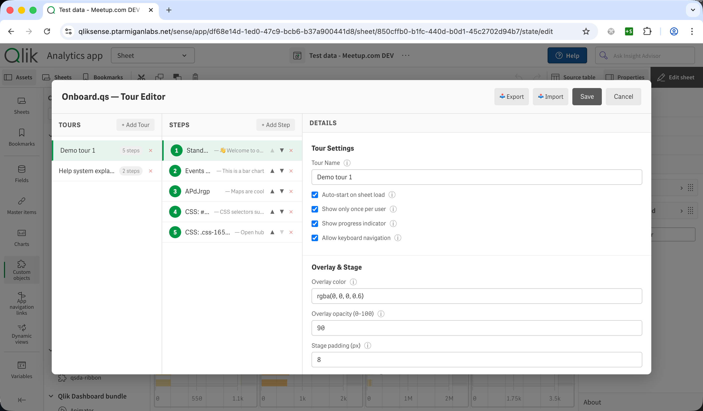

# Onboard.qs tutorial: learn it from the demo apps

Onboard.qs adds guided tours to Qlik Sense apps. A tour is a series of steps. Each step highlights
something on the screen, such as a chart, a button in the Sense toolbar, or nothing at all, and shows a
popover next to it with text you write. The tours live in an Onboard.qs object on a sheet, so they are
part of the app: they are published, exported and moved along with it.

This tutorial is for Sense developers who know their way around Sense, but haven't used Onboard.qs
yet. It is built around two demo apps and goes through them one sheet at a time: what users see, how
it is configured, and how to do the same in your own apps. It finishes with how to use tours to tell
users what the numbers mean, in a way you control.

- [The demo apps](#the-demo-apps)
- [How Onboard.qs is organised](#how-onboardqs-is-organised)
- [Sheet 1: a welcome tour that explains Sense itself](#sheet-1-a-welcome-tour-that-explains-sense-itself)
- [Sheet 2: tours that react to the data](#sheet-2-tours-that-react-to-the-data)
- [Sheet 3: a hidden object and a look of its own](#sheet-3-a-hidden-object-and-a-look-of-its-own)
- [Sheet 4: a banner button and a closing dialog](#sheet-4-a-banner-button-and-a-closing-dialog)
- [The Swedish app: tours in another language](#the-swedish-app-tours-in-another-language)
- [Tours as governed messages about your data](#tours-as-governed-messages-about-your-data)
- [Things to know before you build your own](#things-to-know-before-you-build-your-own)

---

## The demo apps

There are two versions of the same app:

- **Onboard.qs demo (EN)**, in English.
- **Onboard.qs demo (SE)**, the same app in Swedish: data, charts and tours.

The data is a small sales and organisation data set that the load script generates itself, so the
apps reload anywhere without data connections. It has 1,000 orders from January 2024 to August 2026,
24 customers in 11 countries, and 47 employees, with amounts in SEK.

Each of the four sheets has one Onboard.qs object, and each object is set up differently, so between
them they cover most of what Onboard.qs can do:

| Sheet                       | Tours                                                         | What it shows                                                                                                                                                                                                         |
| --------------------------- | ------------------------------------------------------------- | --------------------------------------------------------------------------------------------------------------------------------------------------------------------------------------------------------------------- |
| 1. Sales overview           | _Welcome: find your way around_, _Reading the sales overview_ | A tour that starts by itself, once. Steps that point at Sense's own toolbar: **Sheets**, **Bookmarks**, Smart search, the selections bar. A toolbar button. Text from Qlik expressions. A step the user can click in. |
| 2. Products & profitability | _Profitability explained_, _Deep dive: ‹category›_            | An HTML table in a step. A tour that is only offered when exactly one category is selected, and whose name and text are all expressions.                                                                              |
| 3. Customers & channels     | _Customers and channels_                                      | An object that is hidden on the sheet, with the tour started from the toolbar. A custom overlay, highlight and button labels.                                                                                         |
| 4. Organisation             | _The organisation_                                            | A button that fills a full-width strip across the sheet. A closing dialog with an image.                                                                                                                              |

Each object also uses a different theme preset (_The Lean Green Machine_, _Corporate Blue_, _Corporate
Gold_ and _Default_), so you can compare them.

### What you need

- **Onboard.qs 1.8.2 or later**, installed as described in the README's
  [Getting Started](../README.md#getting-started).
- **Qlik Sense Enterprise on Windows** (client-managed). The demo apps were built and tested on May 2026
  Patch 3. Onboard.qs also runs on Qlik Cloud, but the welcome tour's toolbar steps were written for
  the client-managed toolbar and haven't been tried on Qlik Cloud. A step whose selector matches
  nothing shows as a dialog in the middle of the screen, with nothing highlighted.
- **The demo apps.** Import `Onboard.qs demo (EN).qvf`, and `Onboard.qs demo (SE).qvf` if you want the
  Swedish one too, from [`docs/demo-app/`](demo-app/) through the QMC (**Apps** › **Import**). The
  files include their data, so there's nothing to reload. Open the app from the hub and go to sheet 1.

Everything below is also spelled out in settings tables and expressions, so you can rebuild any part of
it in an app of your own without the demo apps.

---

## How Onboard.qs is organised

A few terms first, since the rest of the tutorial uses them.

- **The object.** Onboard.qs is an extension. In edit mode you find it under **Custom objects** ›
  **.qs Library**, and drag it onto a sheet like any chart. One object holds any number of tours. You
  can put several objects on a sheet.
- **A tour** is a named list of steps with its own settings: whether it starts by itself, whether only
  once, when it's offered at all, how the backdrop looks, and what the step buttons say.
- **A step** is a target plus a popover. The **Target type** is one of three:
    - **Sheet Object**: a chart or other object on the sheet, picked from a list.
    - **Custom CSS Selector**: any element on the page, including Sense's own toolbar.
    - **Standalone Dialog (no target)**: a dialog in the middle of the screen, for welcomes, summaries
      and anything that isn't about one object.
- **Starting a tour.** Users start tours from the object's button on the sheet, or from a button
  Onboard.qs adds to the Sense toolbar. A tour can also start by itself when the sheet opens. When an
  object has more than one tour to offer, its button opens a menu of them.

There are two places to configure all this, and they edit the same settings:

- **The property panel**, under **Tours**, **Widget Appearance** and **Theme & Styling**.
- **The tour editor.** In edit mode the object shows an **Edit Tours** button, which opens a larger
  editor with a Markdown editor for step texts, and **Export** and **Import** buttons for moving tours
  between apps.

Step descriptions are Markdown, and can mix in HTML. Text fields such as tour names, step titles, step
descriptions and button labels also take **Qlik expressions**: start the value with `=`, the same as
anywhere else in Sense.

---

## Sheet 1: a welcome tour that explains Sense itself

### What users see

The first time someone opens sheet 1, the tour _Welcome: find your way around_ starts by itself. It
has seven steps:

1. A welcome dialog in the middle of the screen.
2. The **Sheets** button in the toolbar, and what the sheet panel is for.
3. The **Bookmarks** button: what a bookmark is, and how to apply and create one.
4. **Smart search**.
5. The **selections bar**.
6. The **Tours** button that Onboard.qs added to the toolbar, where the other tours are.
7. A closing dialog.

After that, the tour doesn't start by itself again in that browser. The **Take a tour** button on the
sheet and the **Tours** button in the toolbar both list the sheet's two tours, so users can run either
one at any time.

Many users never learn what the buttons along the top of Sense do. A welcome tour like this one teaches
the app's controls first, before it explains any data.

### How it's configured

The object's settings, under **Widget Appearance** and **Theme & Styling**:

| Setting             | Value                  | Effect                                            |
| ------------------- | ---------------------- | ------------------------------------------------- |
| Button text         | `Take a tour`          | The button on the sheet.                          |
| Button style        | Primary (filled)       |                                                   |
| Show toolbar button | On                     | Adds a button to the Sense toolbar.               |
| Toolbar button text | `Tours`                |                                                   |
| Hide hover menu     | On                     | Users don't get Sense's hover menu on the button. |
| Hide context menu   | On                     | Nor the right-click menu.                         |
| Theme preset        | The Lean Green Machine |                                                   |

The tour's settings:

| Setting                      | Value | Effect                                                  |
| ---------------------------- | ----- | ------------------------------------------------------- |
| Auto-start on sheet load     | On    | Starts when the sheet opens.                            |
| Show only once per user      | On    | ...but only the first time, in each browser.            |
| Version (increment to reset) | 1     | Raise it to show the tour once more to everyone.        |
| Allow keyboard navigation    | On    | Arrow keys move between steps, and Esc closes the tour. |
| Overlay opacity (0–100)      | 70    | How dark the backdrop is.                               |

And its steps:

| #   | Target type         | Target                                          | Title                             |
| --- | ------------------- | ----------------------------------------------- | --------------------------------- |
| 1   | Standalone Dialog   |                                                 | 👋 Welcome to the Onboard.qs demo |
| 2   | Custom CSS Selector | `[data-tid="assets-button-sheets"]`             | 📄 Sheets                         |
| 3   | Custom CSS Selector | `[data-tid="assets-button-bookmarks"]`          | 🔖 Bookmarks                      |
| 4   | Custom CSS Selector | `[tid="toggleGlobalSearchButton"]`              | 🔍 Smart search                   |
| 5   | Custom CSS Selector | `[data-testid="qs-sub-toolbar-selection-list"]` | Your selections                   |
| 6   | Custom CSS Selector | `#oqs-toolbar-container`                        | 🎓 More tours                     |
| 7   | Standalone Dialog   |                                                 | You're all set                    |

Every step has **Disable interaction during step** on, so a click on the highlighted button doesn't open
a panel halfway through the tour. The toolbar steps use **Popover position** _Bottom_ and **Popover
alignment** _Start_, which keeps the popover inside the window for buttons near its left edge; step 6
uses _End_, since the Tours button is on the right.

### Techniques worth copying

**Auto-start and "show once".** When a tour closes, whether the user finished it or pressed Esc halfway,
Onboard.qs records that in the browser's localStorage, under a key that combines the app, the sheet,
the tour and its version: `onboard-qs:<appId>:<sheetId>:<tourId>:v<version>`. Auto-start skips any
tour that is already recorded. Three things follow from that:

- It is per browser, not per Sense user. Someone who switches to another browser or clears their site
  data gets the tour again.
- When the tour's content changes enough that everyone should see it again, raise **Version (increment
  to reset)** in the property panel (**Tours** › your tour › **Auto-start**). The new version has a
  new key, so it counts as unseen.
- While you're building a tour, either raise the version each time or delete the `onboard-qs:` key in
  your browser's developer tools (**Application** › **Local Storage**) to see the auto-start again.

"Show once" only limits auto-start. Users can always start the tour again from the buttons.

**A known problem with auto-start.** In Onboard.qs 1.8.2, an auto-start tour starts again each time its
object gets a new layout, and that happens on every selection if any tour on the object contains an
expression ([#285](https://github.com/ptarmiganlabs/onboard.qs/issues/285)). With "show once" off, the
tour comes back after every selection. With it on, a selection made during the tour sends the user back
to step 1. Until it's fixed, put auto-start tours on an Onboard.qs object whose tours have no
expressions. Or keep "show once" on and block clicks while the tour runs, as the welcome tour does.

**Pointing at Sense's own toolbar.** A step with **Custom CSS Selector** can highlight any element on the
page. To find a selector, right-click the element in the browser, choose **Inspect**, and look for an
attribute that is the same in every UI language: an `id`, a `data-tid`, a `data-testid` or a `tid`. In
the client-managed toolbar, each of the Sense elements the welcome tour points at has one:

| Element        | Selector                                        |
| -------------- | ----------------------------------------------- |
| Sheets         | `[data-tid="assets-button-sheets"]`             |
| Bookmarks      | `[data-tid="assets-button-bookmarks"]`          |
| Smart search   | `[tid="toggleGlobalSearchButton"]`              |
| Selections bar | `[data-testid="qs-sub-toolbar-selection-list"]` |

Don't be tempted by the `title` attribute, even though it's often the easiest thing to spot in the
inspector. It holds the button's tooltip, which is translated into the user's UI language and changes
while a panel is open: _Show sheets_ becomes _Hide sheets_. A step whose selector matches nothing has
nothing to highlight, so for users in another language it shows as a dialog in the middle of the
screen. Steer clear of classes like `css-1x2y3z` as well: Sense generates them, and they can change with
any release.

To check a selector, run `document.querySelectorAll('[data-tid="assets-button-sheets"]').length` in the
browser's console. It should return 1. If more than one element matches, the step highlights the first
one on the page.

None of these attributes is a documented Qlik API, so they can change between Sense releases. Run your
tours once after each Sense upgrade.

**Pointing at Onboard.qs's own button.** `#oqs-toolbar-container` is the container Onboard.qs adds to the
Sense toolbar. Step 6 points at it to show users where to find more tours. If several objects on a
sheet have **Show toolbar button** on, their tours are merged into that one button.

### The second tour: _Reading the sales overview_

This tour doesn't start by itself. It walks through the sheet's charts: the KPIs, the line chart of
sales over time, sales by product category and by region, and the customer table.

- **Sheet Object targets.** Steps 1 to 6 use **Target type** _Sheet Object_ and pick the chart from the
  **Target object** list. The step stores the chart's object ID, so renaming the chart doesn't break
  it.
- **A title that is an expression.** Step 1's title is

    ```
    ='Sales: ' & Num(Sum(Sales)/1000000, '#,##0.0') & ' MSEK'
    ```

    With no selections it reads _Sales: 111.9 MSEK_. With a selection, it shows the selected figure.

- **A step the user can click in.** Step 3 highlights the line chart with **Disable interaction during
  step** off, and its text invites the user to select a few months. The KPIs and charts on the sheet
  follow the selection, and so do the charts the rest of the tour highlights.
- **A description that is an expression.** The last step's description is built with an expression, and
  includes Markdown: `**` for bold, and `Chr(10) & Chr(10)` for a paragraph break.

    ```
    ='When this tour started you were looking at **' & Num(Sum(Sales)/1000000, '#,##0.0')
     & ' MSEK** of sales, at a gross margin of **' & Num(Sum(GrossProfit)/Sum(Sales), '0.0%') & '**.'
     & Chr(10) & Chr(10) & 'This text is a Qlik expression, worked out when the tour starts. ...'
    ```

There is one catch, and the text above says it outright: **expressions are evaluated once, when the
tour starts.** A selection the user makes in step 3 changes the charts, but not the text of the steps
that follow. To see the text for a new selection, the user starts the tour again. Re-evaluating
expressions at each step is requested in
[ptarmiganlabs/onboard.qs#280](https://github.com/ptarmiganlabs/onboard.qs/issues/280).

### Try it: a welcome tour in your own app

This rebuilds steps 1 to 3 of the welcome tour, and takes about five minutes.

1. Open one of your apps, go to a sheet and switch to edit mode.
2. From **Custom objects** › **.qs Library**, drag **Onboard.qs** onto the sheet. A small cell is
   enough.
3. Click **Edit Tours** on the object, then **+ Add Tour**, and name the tour `Welcome`.
4. Click **+ Add Step**. Set **Target Type** to _Standalone Dialog (no target)_, and write a title and
   a few lines of welcome.
5. Click **+ Add Step** again. Set **Target Type** to _Custom CSS Selector_ and **CSS Selector** to
   `[data-tid="assets-button-sheets"]`. Set **Popover Side** to _Bottom_ and **Popover Align** to
   _Start_, and tell users what the sheet panel is for.
6. Do the same for the Bookmarks button, with `[data-tid="assets-button-bookmarks"]`.
7. In the tour's settings, turn on **Auto-start on sheet load** and **Show only once per user**.
8. Click **Save** and leave edit mode. The tour starts.

---

## Sheet 2: tours that react to the data

### What users see

The **Profitability tour** button starts _Profitability explained_, seven steps on where the margin
goes. Its last step suggests selecting one product category, for example by clicking a bar, and then
clicking the button again. Now the button opens a menu with a second tour, named after the category:
_Deep dive: Hardware_, say. That tour is calculated from the selection, down to its name.

### How it's configured

The object uses **Button style** _Pill (rounded)_ and the _Corporate Blue_ preset, with **Show toolbar
button** off: on this sheet the tours start only from the button on the sheet.

**Profitability explained**

- **Step 1** is a _Standalone Dialog_ with **Dialog size** _Large (640 × 420)_. Its description is
  Markdown with an HTML table in the middle, showing sales and margin per product category. Markdown
  and HTML can be mixed freely; the README's
  [Markdown & HTML in Step Descriptions](../README.md#markdown--html-in-step-descriptions) lists what is
  allowed.
- **Step 4**'s title is an expression, so it shows the gross margin of whatever is selected:

    ```
    ='Gross margin: ' & Num(Sum(GrossProfit)/Sum(Sales), '0.0%')
    ```

**Deep dive: ‹category›**

This tour has three settings that make it work:

| Setting        | Value                                              |
| -------------- | -------------------------------------------------- |
| Tour name      | `='Deep dive: ' & Only(ProductCategory)`           |
| Show condition | `=If(GetSelectedCount(ProductCategory) = 1, 1, 0)` |
| Auto-start     | Off                                                |

A **show condition** is an expression that returns 1 to show the tour and 0 to hide it. A tour's show
condition is evaluated along with the rest of the object, so the menu updates as soon as the selections
change: with exactly one category selected, the button offers two tours; otherwise it offers one, and
starts it directly.

The condition also protects the rest of the tour. `Only(ProductCategory)` returns nothing when more than
one category is possible, so a tour whose texts depend on it should only be offered when there is
exactly one.

The steps' texts are expressions too. Step 1 compares the selection with the whole business, using
`{1}` set analysis to ignore the selection:

```
='**' & Only(ProductCategory) & '** sold ' & Num(Sum(Sales)/1000000, '#,##0.0') & ' MSEK over the period, '
 & Num(Sum(Sales)/Sum({1} Sales), '0%') & ' of all sales.' & Chr(10) & Chr(10)
 & 'Its gross margin is **' & Num(Sum(GrossProfit)/Sum(Sales), '0.0%') & '**, against '
 & Num(Sum({1} GrossProfit)/Sum({1} Sales), '0.0%') & ' for the business as a whole.'
```

Step 2 names the best-selling product and the one with the best margin, with `FirstSortedValue()` over
an `Aggr()`:

```
='Best seller: ' & FirstSortedValue(Product, -Aggr(Sum(Sales), Product))
```

Steps have show conditions too, under **Step Settings** › **Show condition**. They are evaluated when
the tour starts, and a hidden step is left out of the tour.

---

## Sheet 3: a hidden object and a look of its own

### What users see

There is no tour button on this sheet. Instead the toolbar has a **Sheet tour** button, and its tour,
_Customers and channels_, looks different from the others: a dark blue backdrop, rounder highlights,
and _‹ Back_, _Next ›_ and _Finish_ buttons.

### How it's configured

| Setting                            | Value                        | Effect                                                            |
| ---------------------------------- | ---------------------------- | ----------------------------------------------------------------- |
| Show toolbar button                | On                           |                                                                   |
| Toolbar button text                | `Sheet tour`                 |                                                                   |
| Hide sheet widget                  | On                           | The object is hidden on the sheet in analysis mode.               |
| Theme preset                       | Corporate Gold               |                                                                   |
| Overlay color                      | `#0C3256`                    | A dark blue backdrop instead of the default black.                |
| Overlay opacity (0–100)            | 75                           |                                                                   |
| Stage padding (px)                 | 12                           | More space between the highlighted object and the highlight edge. |
| Stage border radius (px)           | 12                           | Rounder corners on the highlight.                                 |
| Next / Previous / Done button text | `Next ›`, `‹ Back`, `Finish` |                                                                   |

**Hide sheet widget** only appears in the property panel when **Show toolbar button** is on, since
otherwise users would have no way to start the tour. In edit mode the object stays visible, so you can
still select and edit it. Its grid cells stay empty in analysis mode, though: other objects don't move
into the space. On this sheet the object sits in a narrow strip next to the customer table.

The first step points at the toolbar button (`#oqs-toolbar-container`) and explains why there is no
button on the sheet. Use this setup when every bit of sheet space counts, or when you want tours
available without changing a sheet's layout.

---

## Sheet 4: a banner button and a closing dialog

### What users see

A full-width strip across the top of the sheet is one big button: **🏢 Take the organisation tour**.
The tour's last step is a larger dialog, with a short guide to building tours and a screenshot of the
tour editor.

### How it's configured

The object is placed across all 24 columns of the top grid row, and has **Fill entire widget** on, so
the button covers the whole object. It uses the _Default_ theme preset.

The last step is a _Standalone Dialog_ with **Dialog size** _Large (640 × 420)_. Its description mixes
a Markdown numbered list with an HTML `` tag:

```html

```

It's an HTML tag rather than Markdown's `` because of the `max-height`. The dialog sizes set a
minimum size, but nothing stops a dialog from growing taller than the browser window, and step dialogs
don't scroll. A full-width screenshot can push the step buttons off the bottom of a short window. So:
keep long texts out of tours, prefer **Dialog size** _Dynamic (fit content)_, and cap image heights.
Keeping popovers inside the window is requested in
[ptarmiganlabs/onboard.qs#281](https://github.com/ptarmiganlabs/onboard.qs/issues/281).

---

## The Swedish app: tours in another language

_Onboard.qs demo (SE)_ is the same app, with the same object IDs, in Swedish. Comparing the two shows
what a translation involves.

**The text you write.** Tour names, step titles and descriptions, the button texts on the sheet and in
the toolbar, and the step buttons, which are set per tour under **Button Labels**: _Nästa_,
_Föregående_ and _Klar_ in the Swedish app. Use the words your users see in their own Sense UI. If a
step tells users to click _Clear all selections_, the Swedish text says _Rensa alla urval_, because
that's what the button is called in a Swedish Sense.

**What stays the same.** The selectors. Both welcome tours point at the toolbar buttons with the same
`data-tid`, `data-testid` and `tid` attributes, which don't change with the user's UI language. Had the
tours used the buttons' titles instead, each app would need every language's tooltip, both with the
panel open and closed.

**Number formats in expressions.** `Num()` format codes use the app's own separators, which the load
script sets with `DecimalSep` and `ThousandSep`. The Swedish app uses a decimal comma and a space as the
thousands separator, so its expressions use `'# ##0,0'` and `'0,0 %'`:

```
='Försäljning: ' & Num(Sum(Sales)/1000000, '# ##0,0') & ' MSEK'
```

The English format `'#,##0.0'` gives wrong numbers in that app.

**The progress counter.** From Onboard.qs 1.9.0, _1 of 7_ is set per tour as **Progress text**, under
**Button Labels** in the property panel or **Navigation Buttons** in the tour editor. In Swedish that's
`{{current}} av {{total}}`: the step number goes in place of `{{current}}` and the number of steps in
place of `{{total}}`, once each. In 1.8.2 the counter is always English, and the demo apps don't set it
yet.

The demo uses one app per language. Since nearly every text field takes an expression, one app can also
carry both, picking each text from a variable or a language field, for example
`=If(vLanguage = 'sv', 'Nästa', 'Next')`. That isn't used in the demo apps, and means more expressions
to maintain.

---

## Tours as governed messages about your data

Every app has a story the developer and the business owner want users to take away: which numbers
matter, how to read them, what they mean. That story usually lives outside the app, in an email, a
slide deck or a wiki page, and drifts out of date while the app moves on.

The demo apps put it in the app, as tours, next to the charts it is about. _Reading the sales overview_
says which KPIs to look at first. _Profitability explained_ says where the margin goes. The
organisation tour says who carries the sales. Done this way, the message is governed:

- **It goes through the same process as the app.** Tour texts are object properties. They are
  developed, reviewed, tested and published along with the sheets they describe, and move between
  environments with the app.
- **Users can't change it.** In a published app, users see the tours on the published sheets but can't
  edit them.
- **Changes reach everyone.** When the message changes, raise the tour's version, and every user sees
  it once more on their next visit.
- **It can be shared.** A standard tour, such as the welcome tour that explains the toolbar, can be
  exported from one app and imported into others with the tour editor's **Export** and **Import**. The
  import offers _Replace matching_, _Replace all_ and _Add to existing_.

### Keep the statements true

A tour states facts about data, and the data changes with every reload. The demo apps use three kinds
of statement, and they age differently:

1. **Computed figures**, such as `='Gross margin: ' & Num(Sum(GrossProfit)/Sum(Sales), '0.0%')`. Always
   right when the tour starts.
2. **Computed conclusions**, such as the deep-dive tour's best seller, found with `FirstSortedValue()`,
   or the comparison with the whole business using `{1}`. Also always right, and they can name things,
   not only count them.
3. **Conclusions in plain text**, such as _"Over the whole period, Professional Services is the biggest
   by far"_. Easy to write and easy to read, and true for the data the developer looked at, but nothing
   checks them after a reload.

For a plain-text conclusion that matters, you can do one of two things:

- **Compute it**, so the text always names the right category:

    ```
    ='Over the whole period, **' & FirstSortedValue({1} ProductCategory, -Aggr({1} Sum({1} Sales), ProductCategory))
     & '** is the biggest product category.'
    ```

- **Guard it** with a step show condition, so the step is only shown while the statement holds:

    ```
    =If(FirstSortedValue({1} ProductCategory, -Aggr({1} Sum({1} Sales), ProductCategory)) = 'Professional Services', 1, 0)
    ```

    If another category ever overtakes Professional Services, the step quietly drops out of the tour
    instead of telling users something false. The demo apps don't do this, but it works the same way as
    the show conditions on sheet 2.

The `{1}` makes both expressions ignore the user's selections, so they are about the whole data set
whatever is selected when the tour starts. Leave it out for statements that should follow the
selection.

---

## Things to know before you build your own

- **"Show once" is per browser.** It is stored in localStorage, not on the server. Raise the tour's
  version to show it again.
- **Auto-start tours can restart on a selection** if any tour on the same object contains an expression
  ([#285](https://github.com/ptarmiganlabs/onboard.qs/issues/285)). Keep auto-start tours on an object
  without expressions.
- **Expressions are evaluated when the tour starts**, not at each step
  ([#280](https://github.com/ptarmiganlabs/onboard.qs/issues/280)).
- **Step dialogs don't scroll.** Keep texts short, prefer _Dynamic (fit content)_, and cap image heights
  ([#281](https://github.com/ptarmiganlabs/onboard.qs/issues/281)).
- **Selectors for Sense's own UI can break.** Titles change with the UI language, and generated classes
  with the Sense version. Use `id`, `data-tid`, `data-testid` and `tid` attributes, and run your tours
  after each Sense upgrade.
- **The progress text is English in 1.8.2.** From 1.9.0 it's set per tour
  ([#282](https://github.com/ptarmiganlabs/onboard.qs/issues/282)).
- **Several objects on a sheet** share one toolbar button, which lists all their tours.

## Further reading

- [README](../README.md): installation, and every setting in the
  [Configuration Reference](../README.md#configuration-reference).
- [TOUR-SYSTEM.md](TOUR-SYSTEM.md): how tours run under the hood.
- [SELECTORS.md](SELECTORS.md): the selectors Onboard.qs itself uses for Sense's UI.
