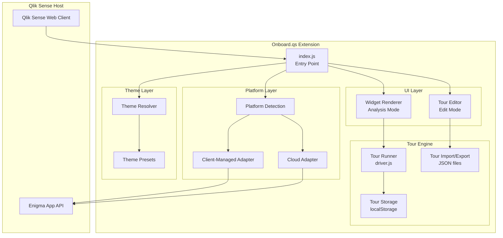
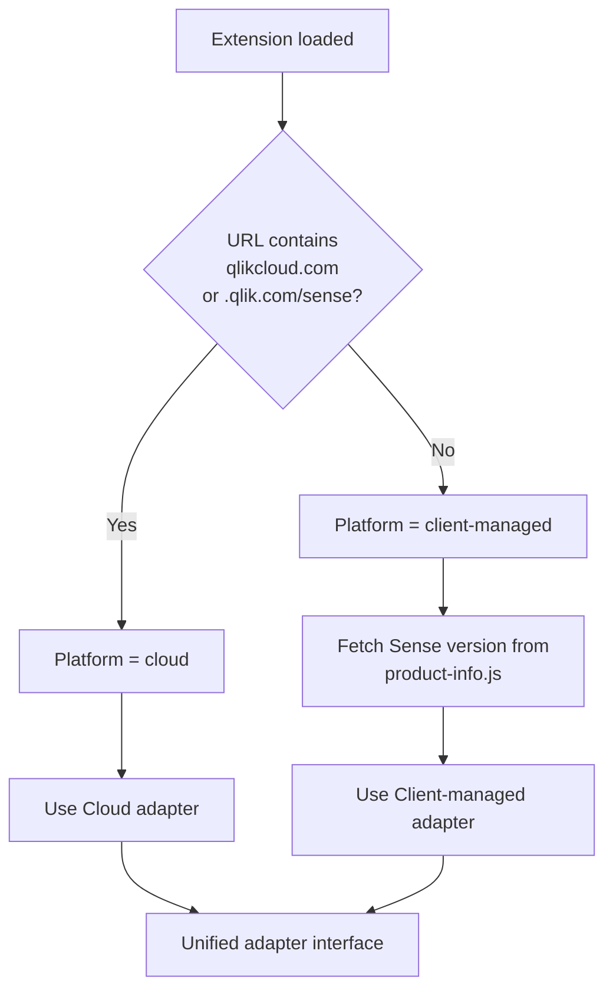

# Development Guide

This document covers building, extending, and contributing to the Onboard.qs extension.  
For **installation and usage**, see the main [README](../README.md).

---

## Prerequisites

- Node.js ≥ 24.15 and npm
- Git

## Getting the Source

```bash
git clone https://github.com/ptarmiganlabs/onboard.qs.git
cd onboard.qs
npm install
```

## Build Commands

| Command                | Description                                                                                                                      |
| ---------------------- | -------------------------------------------------------------------------------------------------------------------------------- |
| `npm run pack:dev`     | Development build → `onboard-qs.zip` (with logging)                                                                              |
| `npm run pack:prod`    | Production build → `onboard-qs.zip` (minified, no debug logs)                                                                    |
| `npm run build`        | Development build of `dist/` only (no zip)                                                                                       |
| `npm run build:dist`   | Production build of `dist/` only (minified, no zip)                                                                              |
| `npm run sense`        | `nebula sense`: builds the Sense extension folder `onboard-qs-ext/`, with its `.qext`, from `dist/`                              |
| `npm run post-build`   | Fails if a version, build-type or build-date token is left in `dist/` or `onboard-qs-ext/`, then adds bundle metadata to `.qext` |
| `npm run generate-pdf` | Writes `README.pdf` from `README.md`, with the Mermaid diagrams drawn. CI puts it in the release zip                             |
| `npm run zip`          | Zips `onboard-qs-ext/` and `README.md` into `onboard-qs.zip`, and fails the build if either is missing                           |
| `npm test`             | Unit tests in `test/`, with Node's built-in test runner                                                                          |
| `npm run lint`         | ESLint check                                                                                                                     |
| `npm run lint:fix`     | ESLint auto-fix                                                                                                                  |
| `npm run format`       | Format all files with Prettier                                                                                                   |
| `npm run format:check` | Check formatting without modifying files                                                                                         |
| `npm run start`        | nebula serve (local dev mode)                                                                                                    |
| `npm run cloc`         | Count lines of code                                                                                                              |

The `pack:prod` script is the main build pipeline: it runs `build:dist` (Rollup bundle), `sense` (the extension folder and its metadata), `post-build` (a check that Rollup replaced every build token, and `.qext` metadata), `generate-pdf` (`README.pdf`) and `zip` (creates `onboard-qs.zip`). `pack:dev` runs the same steps with the development build.

For full details on the build toolchain, see [BUILD-AND-DEPLOYMENT.md](BUILD-AND-DEPLOYMENT.md).

---

## Project Structure

```text
onboard.qs/
├── package.json              # Project manifest, scripts, dependencies
├── nebula.config.cjs         # nebula build's options: the build tokens for Rollup to replace
├── eslint.config.js          # ESLint flat config
├── scripts/
│   ├── build-date.cjs        # Shared build-date generator (CJS)
│   ├── build-tokens.cjs      # The build tokens (version, build type, build date) and their values
│   ├── post-build.mjs        # Fails on a build token left in a bundle; .qext bundle metadata
│   ├── generate-readme-pdf.mjs # README.md → README.pdf for the release zip, Mermaid diagrams drawn
│   └── zip-extension.mjs     # Zip builder for Sense deployment
├── test/                     # Unit tests, run with `npm test` (node --test)
│   └── support/              # Stand-ins for driver.js, DOMPurify, the DOM and Qlik-bound modules
└── src/
    ├── index.js              # Supernova entry point (hooks, lifecycle)
    ├── object-properties.js  # Default object properties
    ├── meta.json             # Extension metadata (name, icon, type)
    ├── style.css             # All CSS: widget, editor, driver.js theme
    ├── ext/
    │   ├── index.js          # Property panel definition
    │   ├── tours-section.js  # Tours section, Target object dropdown
    │   ├── widget-section.js # Widget Appearance section
    │   ├── theme-section.js  # Theme & Styling section
    │   ├── theme-helpers.js  # Color keys and preset helpers for the theme section
    │   ├── security-section.js # Security section (URI allowlist)
    │   ├── about-section.js  # About section
    │   └── lui-icons.js      # Lui icons for the button icon picker
    ├── platform/
    │   ├── index.js          # Platform detection + selector helper
    │   ├── selectors.js      # Versioned CSS selector registry
    │   ├── client-managed.js # Client-managed Sense DOM helpers
    │   └── cloud.js          # Qlik Cloud adapter
    ├── tour/
    │   ├── tour-runner.js    # driver.js integration: build steps, run/highlight/destroy
    │   ├── tour-helpers.js   # startTour(), auto-start and sheet visits
    │   ├── tour-storage.js   # localStorage "show once" tracking
    │   └── tour-io.js        # Tour import/export (JSON serialization, merge modes)
    ├── theme/
    │   ├── resolve.js        # Theme resolver (preset + overrides → CSS vars)
    │   └── presets.js        # Built-in theme presets (4 presets)
    ├── ui/
    │   ├── widget-renderer.js # Analysis mode: start button and tour dropdown
    │   ├── toolbar-injector.js # Tour button in the Sense toolbar
    │   ├── tour-editor.js    # Full-screen modal editor (3-panel layout)
    │   ├── confirm-discard.js # Unsaved-changes confirmation dialog
    │   ├── markdown-editor-dialog.js # Property panel's Markdown editor dialog
    │   └── markdown-toolbar.js # Tabbed Write/Preview Markdown editor
    └── util/
        ├── css-selector.js   # Checks for step CSS selectors
        ├── dialog-size.js    # Dialog-size presets for steps
        ├── expressions.js    # Qlik expression values (=expr ↔ qStringExpression)
        ├── extension-state.js # Shared state (model and app refs, tabContainerMap)
        ├── logger.js         # Build-type-aware console logger
        ├── markdown.js       # Mini Markdown-to-HTML converter
        ├── markdown-shortcuts.js # Markdown keyboard shortcuts
        ├── sanitize.js       # Lui icon name sanitizer
        ├── tab-switcher.js   # Tab container auto-switching
        ├── uuid.js           # UUID v4 generator
        └── visibility.js     # Show conditions of tours and steps
```

---

## How It Works

1. **Edit mode**: The extension renders a placeholder with its tour and step counts, and **Edit Tours** and **About** buttons. **Edit Tours** opens a full-screen modal with three panels — tour list, step list, and detail editor. Alternatively, use the Qlik property panel on the right. Its Tours section has an **Open tour editor** button that opens the same editor.

2. **Analysis mode**: The extension renders a start button (or auto-starts), and with **Show toolbar button** on, a tour button in the Sense toolbar too. When triggered, it builds a driver.js configuration from the saved tour steps, resolving sheet objects to live DOM elements via CSS class selectors (`.qv-object-{objectId}`), and runs the tour. Objects inside **tab containers** are handled automatically — the extension switches to the correct tab and waits for the element to render before highlighting.

3. **Show-once**: When a tour ends, whether by **Done**, the close button, Esc or leaving the sheet, a localStorage key (`onboard-qs:{appId}:{sheetId}:{tourId}:v{version}`) is written. With **Show only once** on, which is the default, auto-start skips a tour whose key is present. With it off, the tour auto-starts on every visit. Either way, a tour auto-starts at most once per visit to the sheet. See [Auto-start tours](TOUR-SYSTEM.md#auto-start-tours).

4. **Markdown**: Step descriptions are converted from Markdown to HTML by a built-in mini parser ([src/util/markdown.js](../src/util/markdown.js)) before being passed to driver.js popovers.

### Architecture Overview

The following diagram shows how the major components interact:



For a detailed architecture breakdown, see [ARCHITECTURE.md](ARCHITECTURE.md).

---

## Platform Detection

Platform detection is **automatic** — the extension checks `window.location.href` at startup to determine whether it is running on Qlik Cloud or client-managed Qlik Sense:



Both platforms share an identical adapter interface:

| Function                      | Description                                           |
| ----------------------------- | ----------------------------------------------------- |
| `getCurrentSheetId()`         | Get the active sheet ID (URL parsing + API fallbacks) |
| `getSheetObjects(app)`        | List objects on the current sheet via Engine API      |
| `getObjectSelector(objectId)` | Get the CSS selector for a Qlik object                |
| `isEditMode(options)`         | Check if in edit mode                                 |
| `injectCSS(css, id)`          | Inject a `<style>` element into the page              |

The client-managed adapter additionally detects the running Sense version and maps it to a "code path" for version-specific CSS selector overrides. See [PLATFORM-DETECTION.md](PLATFORM-DETECTION.md) for full details.

---

## Dependencies

| Package                                   | Purpose                                          | Size       |
| ----------------------------------------- | ------------------------------------------------ | ---------- |
| [driver.js](https://driverjs.com/) ^1.3.1 | Tour engine (highlighting, popovers, animations) | ~5 KB gzip |

All other dependencies are dev-only (build tooling).

## Automated Checks

Pre-commit hooks are configured via Husky to ensure code quality and prevent secrets from being committed:

1. **Code Formatting & Linting**: `lint-staged` automatically formats and lints all changed files.
2. **Secret Scanning**: Scans for secrets via Gitleaks before your commit succeeds.
   **Note**: Gitleaks must be installed on your machine.
    - macOS: `brew install gitleaks`
    - Other systems: See [Gitleaks Installation](https://github.com/gitleaks/gitleaks#installation).

If you must bypass these checks, you can use `git commit --no-verify`, though this is not recommended.

---

## Further Reading

| Document                                           | Description                                                               |
| -------------------------------------------------- | ------------------------------------------------------------------------- |
| [ARCHITECTURE.md](ARCHITECTURE.md)                 | Component map, data flow, supernova lifecycle, module-by-module breakdown |
| [BUILD-AND-DEPLOYMENT.md](BUILD-AND-DEPLOYMENT.md) | Build toolchain, npm scripts, post-build processing, deployment           |
| [PLATFORM-DETECTION.md](PLATFORM-DETECTION.md)     | Platform detection, version fetching, adapter interface                   |
| [SELECTORS.md](SELECTORS.md)                       | CSS selector registry design, per-platform/version lookup                 |
| [TOUR-SYSTEM.md](TOUR-SYSTEM.md)                   | Tour data model, step resolution, driver.js integration, import/export    |
| [VIRUS-SCAN.md](VIRUS-SCAN.md)                     | VirusTotal scanning of release artifacts                                  |
