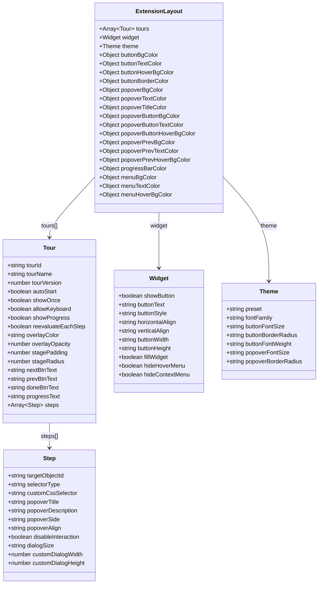
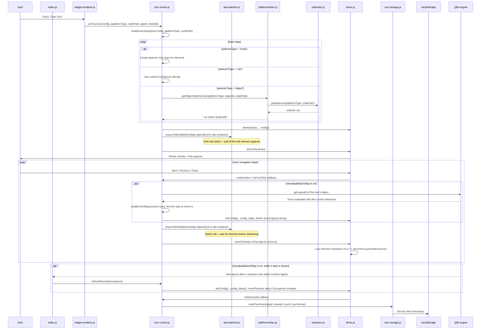
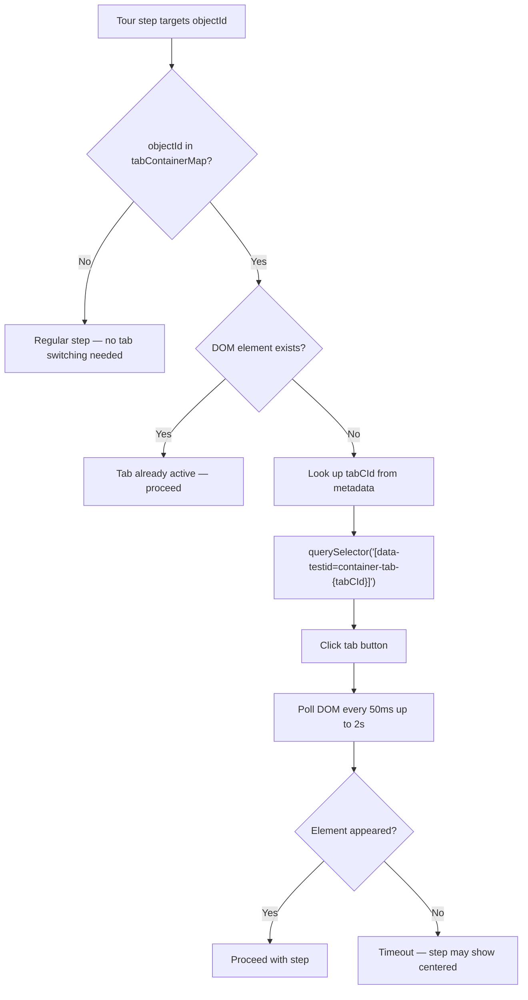
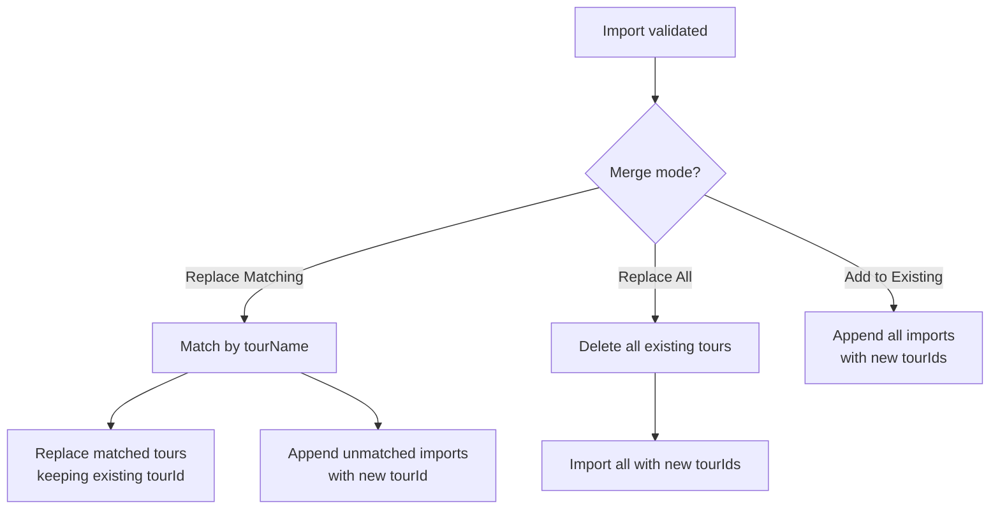

# Tour System

The tour system is the core feature of Onboard.qs. It allows Qlik Sense app developers to create interactive, step-by-step tours that highlight objects on a sheet with informational popovers, powered by [driver.js](https://driverjs.com/).

## Tour data model

Tours are stored in the extension's QAE properties (`layout.tours`). Each tour is an object with the following structure:



### Step selector types

Each step targets a DOM element using one of three selector strategies:

| `selectorType`       | Behavior                                                                                           |
| -------------------- | -------------------------------------------------------------------------------------------------- |
| `'object'` (default) | Uses `targetObjectId` → resolved via `getObjectSelectorSync()` to a `.qv-object-{id}` CSS selector |
| `'css'`              | Uses `customCssSelector` directly. A selector the browser can't parse matches nothing              |
| `'none'`             | No element — driver.js shows a centered modal dialog                                               |

## Tour execution flow



### Updating expressions at each step

Step titles, descriptions and show conditions, and the tour's button and progress texts, can be Qlik expressions. The engine evaluates them in the extension's layout, so `runTour()` receives them already evaluated, with the selections that were active when the tour started. By default the tour keeps those values to the end.

With the tour's **Update expressions at each step** setting (`reevaluateEachStep`) on, the tour reads itself again during the run, so a step that invites the user to make a selection can be followed by steps that respond to it. It does so at two moments.

**At each move.** `onNextClick` and `onPrevClick` both call `move()`, which reads the tour again before moving:

1. It calls `getLayout()` on the object the tour belongs to, and finds the tour in it by `tourId`. `index.js` passes that function, with the object's ID, to `renderWidget()` and to `registerToolbarTours()`, so tours started from the toolbar button read the object they came from. The call goes to the engine directly instead of waiting for the object to render again, because a user can click **Next** before that render arrives. After `LAYOUT_TIMEOUT_MS` (5 seconds) without an answer, the move goes ahead with the steps the tour has.
2. It builds the steps again with `buildDriverSteps()`, which leaves out the steps whose show condition is now false. Each step carries `_configIndex`, its position in the tour's step list, and the step moved to is the first visible step after the one being left (or the last one before it, for **Previous**).
3. It gives driver.js the new steps with `setConfig()`, not `setSteps()`, which would clear the state of the running tour. driver.js reads its steps array each time it shows a step, so the progress counter, the **Done** label and the disabled **Previous** button follow the new list.

**While a step is shown.** The object renders again whenever its layout changes, for example after a selection, and `index.js` then passes the new layout to `refreshRunningTour()`. If the running tour belongs to that object, it builds its steps from the layout the same way and, when anything in the open popover would change, shows the step again: its text, the step count and the **Next** or **Done** label follow the selection in place. A step that the selection has hidden stays on screen until the user moves on. A move under way reads the layout itself, so a refresh that arrives meanwhile is skipped.

Moving past either end does what the popover offered when the user clicked:

- **Done** ends the tour. If a selection made a later step visible, the open popover has usually already changed to **Next**; only a click that beats the new layout ends the tour instead.
- **Next** ends the tour if every later step has been hidden by then.
- **Previous** shows the current step again, with **Previous** disabled, if every earlier step has been hidden. If the current step is hidden too, the tour stays where it is.

driver.js keeps one state for all its instances, so after every await `move()` checks that its tour is still the one running (`activeTour` and `isActive()`), not one the user started after closing it. An error while preparing a move is logged, and the tour moves with the steps it has rather than stay on the current one. If the layout can't be read, or no longer has the tour, the tour keeps the steps it had. The tour's own show condition is not checked again: a running tour isn't closed because it would now be hidden.

## Auto-start tours

Tours with `autoStart: true` are triggered automatically when the sheet loads in analysis mode.

```mermaid
flowchart TD
    A[renderWidget called] --> B[handleAutoStart&#40;tours&#41;]
    B --> C{tour.autoStart?}
    C -- No --> D[Skip]
    C -- Yes --> V{Auto-started already<br/>on this sheet visit?}
    V -- Yes --> W[Skip — once per visit]
    V -- No --> E{tour.showOnce?}
    E -- No --> G[Start tour after 500ms delay]
    E -- Yes --> F{hasSeenTour?}
    F -- Yes --> H[Skip — already seen]
    F -- No --> G
```



The 500ms delay ensures Qlik objects have finished rendering before the tour overlay appears.

`renderWidget()` runs again every time the object gets a new layout. If any of the object's
properties is an expression, that happens on every selection, every **Clear all** and every step
back or forward. So `tour-helpers.js` records the tours auto-started during the current visit to
the sheet, and `handleAutoStart()` skips them. The record belongs to the sheet, not to the object,
because Qlik can destroy and re-create an object while the user stays on the sheet, for example
when a tab container switches tabs. A visit ends when the user switches to edit mode, or when an
object unmounts and the URL shows another sheet. A tour that its show condition hides when the
sheet opens auto-starts the first time it becomes visible.

A re-render or unmount cancels the auto-starts that haven't fired yet, so a burst of layout changes
gives one start, 500ms after the last of them.

`runTour()` doesn't start a tour while another one is running. driver.js runs one tour at a time,
and a second `drive()` would replace the running tour rather than add to it. `runTour()` checks on
entry, and again just before `drive()` with no `await` in between, because waiting for the
tab-container metadata can take a while on a large sheet. The second check also drops a tour whose
sheet the user has left during that wait.

A tour that is already running when its sheet goes away is closed. The tour overlay blocks most
clicks, but a step can leave a button or link that goes to another sheet clickable. When an object
unmounts and the URL shows another sheet, `closeTourForSheet()` closes the tour started on the old
sheet, and that counts as closing it for **Show only once**. Otherwise the old tour would stay on screen, pointing at objects that
are gone, and keep the new sheet's auto-start tour from starting.

So only one auto-start tour runs per visit. When two are due at once, the first to fire runs (on
one object, the first in its tour list) and the other is skipped for that visit. With **Show only
once** on, the other one auto-starts on a later visit, once the first is marked as seen. With it
off, the first one wins every time, so give a sheet only one auto-start tour with **Show only
once** off.

## "Show once" gating (tour-storage.js)

Tour completion is tracked in `localStorage` under keys with the format:

```text
onboard-qs:{appId}:{sheetId}:{tourId}:v{tourVersion}
```

| Function                                         | Purpose                        |
| ------------------------------------------------ | ------------------------------ |
| `hasSeenTour(appId, sheetId, tourId, version)`   | Check if a key exists          |
| `markTourSeen(appId, sheetId, tourId, version)`  | Write key with timestamp JSON  |
| `resetTourSeen(appId, sheetId, tourId, version)` | Remove a single key            |
| `clearAllTourData()`                             | Remove all `onboard-qs:*` keys |

The version dimension allows re-showing a tour when the developer bumps `tourVersion`.

## Step element resolution

driver.js supports both static elements and lazy-evaluated functions. The extension uses **lazy evaluation** — each step's `element` is a function:

```javascript
element: () => document.querySelector(cssSelector);
```

This is critical because:

1. Qlik objects may not be in the DOM when the tour starts (e.g., objects below the fold that render lazily).
2. The DOM can change between step transitions in Qlik Sense.
3. Objects inside tab containers only exist in the DOM when their tab is active (see [Tab container support](#tab-container-support) below).

## Tab container support

Qlik Sense's **tab container** (`sn-tabbed-container`) presents a challenge: inactive tab panels are **lazy-rendered** — their child objects have no DOM elements until the tab is activated. This means `document.querySelector('.qv-object-{id}')` returns `null` for objects on inactive tabs.

Onboard.qs handles this transparently via the `util/tab-switcher.js` module.

### Tab container metadata

At startup (analysis mode), `buildTabContainerMap(app, adapter)` scans the current sheet's objects via the Engine API. For each `sn-tabbed-container` it finds, it reads `qChildList.qItems[]` and builds a lookup map:

```text
extensionState.tabContainerMap = {
    [childObjectId]: {
        containerId: 'parent-tab-container-id',
        tabCId:      'child-ref-id',    // from qData.childRefId
        tabLabel:    'Tab display name'
    }
}
```

This map is stored in `extensionState` (shared mutable state) and consulted by the tour runner before each step.

### Tab switching flow



### Key functions

| Function                                                 | Type  | Description                                                                                |
| -------------------------------------------------------- | ----- | ------------------------------------------------------------------------------------------ |
| `buildTabContainerMap(app, adapter)`                     | async | Scans sheet for tab containers, populates `extensionState.tabContainerMap`                 |
| `getTabInfo(objectId)`                                   | sync  | Looks up tab metadata for a child object (returns `null` if not in a tab container)        |
| `waitForElement(selector, timeout?, interval?)`          | async | Polls the DOM until a matching element appears or timeout expires                          |
| `ensureTabVisible(objectId, platformType, codePath)`     | async | Checks if tab switch is needed, clicks the tab button, waits for the DOM element to appear |
| `ensureTabVisibleSync(objectId, platformType, codePath)` | sync  | Synchronous variant used inside driver.js `element()` callbacks (best-effort, no wait)     |

### Integration with tour runner

Tab switching is integrated at three points in `tour-runner.js`:

1. **First step** — Before calling `driverObj.drive()`, `runTour()` calls `await ensureTabVisible()` for the first step. This is critical because driver.js's `element()` function is synchronous and cannot wait for async tab rendering.

2. **Step navigation** — `onNextClick` and `onPrevClick` callbacks are async. They call `await ensureTabVisible()` for the upcoming step, then call `moveNext()` / `movePrevious()` after the element is in the DOM.

3. **Element resolution fallback** — Each step's `element()` function calls `ensureTabVisibleSync()` as a best-effort synchronous fallback. This handles edge cases like keyboard navigation where the async callbacks may not fire.

### Property panel integration

In the tour editor's object dropdown (populated by `getObjectList()` in `tours-section.js`), objects inside tab containers are labeled with a suffix:

```text
My Chart — Tab: Revenue
Pivot Table — Tab: Details
```

This helps tour authors identify which tab an object belongs to when configuring steps.

## Tour editor (edit mode)

The tour editor is a full-screen modal overlay (`tour-editor.js`, ~879 lines) that opens when the user clicks "Edit Tours" in the extension placeholder, or "Open tour editor" at the top of the property panel's Tours section.

```mermaid
flowchart TD
    subgraph "Tour Editor Modal"
        H[Header: Save / Cancel]
        TL[Tour List Panel<br/>Add, rename, delete tours]
        SL[Step List Panel<br/>Add, reorder, delete steps]
        SF[Step Form Panel<br/>Title, description, target object,<br/>selector type, popover settings]
        PV[Live Preview<br/>highlightStep&#40;&#41;]
    end

    TL --> SL
    SL --> SF
    SF --> PV
    PV --> |driver.js highlight| DOM[Qlik Sheet DOM]
```



### Editor workflow

1. **Open** — Deep-clones `layout.tours` to avoid mutating live properties.
2. **Edit** — User adds/removes tours and steps, configures each step's target object, title, description, popover position.
3. **Preview** — "Preview Step" calls `highlightStep()` which creates a temporary driver.js highlight on the actual Qlik object. Auto-dismisses after 3 seconds.
4. **Save** — Writes the modified tours back via `model.getProperties()` → mutate → `model.setProperties()`.
5. **Cancel** — Discards changes, clones are garbage-collected.

### Object picker

The step form includes a dropdown of all objects on the current sheet. The list is populated by calling `adapter.getSheetObjects(app)`, which uses the Engine API to enumerate objects and enrich their titles.

## Tour import & export

The tour editor includes **Export** and **Import** buttons (in the editor header) powered by `tour/tour-io.js`. This allows tour configurations to be shared across apps, backed up, or migrated between environments.

### Export

Clicking the **Export** button opens a dialog where the user can choose which tours to include and whether to bundle theme/widget settings.

`exportToursAndTheme(layout, options)` serializes the selected tours to a JSON file:

| Field        | Content                                               |
| ------------ | ----------------------------------------------------- |
| `version`    | Schema version (currently `1`)                        |
| `exportedAt` | ISO 8601 timestamp                                    |
| `tours`      | Selected tours (or all, if none are deselected)       |
| `theme`      | Theme configuration (when "Include theme" is checked) |
| `widget`     | Widget settings (when "Include theme" is checked)     |

The export dialog provides:

- **Per-tour checkboxes** — select individual tours to export
- **Select all** toggle — quickly check/uncheck every tour
- **Include theme & widget settings** toggle — optionally omit theme data

The file is downloaded as `onboard-qs-tours.json` via a temporary `<a>` element.

### Import

`importFromFile()` opens a file picker, reads the selected JSON file, and validates it with `validateImportData()`:

- Must be a JSON object with a `tours` array
- Each tour must have a `tourName` (string) and `tourId` (string)
- Each tour must have a `steps` array

After validation, the tour editor shows an **import dialog** where the user selects a merge mode and optionally toggles **Import theme settings**.

### Merge modes

`mergeTours(existingTours, importedTours, mode)` combines tours according to the selected strategy:



### Tour step dialog sizes

Each tour step can choose a predefined dialog size, or stay dynamic so driver.js decides the best fit:

| Size             | CSS class                   | Dimensions                                                    |
| ---------------- | --------------------------- | ------------------------------------------------------------- |
| Dynamic          | `onboard-qs-dialog-dynamic` | Fit content                                                   |
| Small            | `onboard-qs-dialog-small`   | 320 × 220 px                                                  |
| Medium (default) | `onboard-qs-dialog-medium`  | 480 × 320 px                                                  |
| Large            | `onboard-qs-dialog-large`   | 640 × 420 px                                                  |
| Extra Large      | `onboard-qs-dialog-x-large` | 800 × 520 px                                                  |
| Custom           | `onboard-qs-dialog-custom`  | User-specified via `customDialogWidth` / `customDialogHeight` |

Custom dimensions are applied via `onPopoverRender` as inline styles on the popover wrapper. Existing attached
steps remain dynamic by default for backwards compatibility, while standalone dialogs still default to medium.

## Markdown support in descriptions

Step descriptions support a subset of Markdown, converted to HTML by `util/markdown.js`:

| Syntax              | Rendered as     |
| ------------------- | --------------- |
| `**bold**`          | **bold**        |
| `*italic*`          | _italic_        |
| `[text](url)`       | hyperlink       |
| ``       | image           |
| `` `code` ``        | inline code     |
| `### Heading`       | h3–h6           |
| `> quote`           | blockquote      |
| `---`               | horizontal rule |
| `- item` / `* item` | unordered list  |
| `1. item`           | ordered list    |
| double newline      | paragraph break |
| single newline      | `<br>`          |

The converter is intentionally minimal (~112 lines) to keep the bundle small. Its HTML output is sanitised through [DOMPurify](https://github.com/cure53/DOMPurify) before reaching the DOM, preventing cross-site scripting (XSS) attacks.

### Embedded videos

Step descriptions also support embedded videos via raw HTML. The DOMPurify configuration whitelists `<video>`, `<iframe>`, and `<source>` tags along with their common attributes (`controls`, `autoplay`, `muted`, `loop`, `poster`, `allowfullscreen`, `allow`, etc.).

Use the **Large** or **X-Large** dialog size preset for steps containing video — CSS ensures `max-width: 100%` so videos scale responsively within the popover.

```html
<!-- Self-hosted video -->
<video width="400" controls>
    <source src="/content/Default/demo.mp4" type="video/mp4" />
</video>

<!-- YouTube embed -->
<iframe
    width="400"
    height="225"
    src="https://www.youtube.com/embed/VIDEO_ID"
    allowfullscreen
></iframe>
```

> **Note:** `<iframe>` embeds are subject to the browser Content Security Policy (CSP). The tenant or proxy CSP configuration may block external iframe sources.

### Markdown editing features

All Markdown-editable textareas (in the tour editor and the standalone Markdown editor dialog) include:

- **Tabbed Write / Preview** — switch between editing and a live HTML preview
- **Formatting toolbar** — buttons for Bold, Italic, Code, Link, Heading (H3/H4), Bullet list, Numbered list, Blockquote, and Horizontal rule
- **Keyboard shortcuts** — GitHub-style shortcuts (Ctrl on Windows/Linux, Cmd on macOS):

| Shortcut             | With selection        | Without selection           |
| -------------------- | --------------------- | --------------------------- |
| Ctrl/Cmd + B         | `**selected**`        | `**bold**` (placeholder)    |
| Ctrl/Cmd + I         | `*selected*`          | `*italic*` (placeholder)    |
| Ctrl/Cmd + E         | `` `selected` ``      | `` `code` `` (placeholder)  |
| Ctrl/Cmd + K         | `[selected](url)`     | `[text](url)` (placeholder) |
| Ctrl/Cmd + Shift + 7 | Toggle ordered list   | Toggle ordered list         |
| Ctrl/Cmd + Shift + 8 | Toggle unordered list | Toggle unordered list       |
| Ctrl/Cmd + Shift + . | Toggle blockquote     | Toggle blockquote           |

Line-level shortcuts (lists, blockquotes) support toggle behavior — pressing again removes the prefix. They also handle multi-line selections correctly.

The property panel also includes an **"Edit in Markdown editor"** button next to the Popover Description field, which opens a larger modal editor with the same features.

## driver.js configuration

The extension configures driver.js with the following settings. Some are configurable per tour (via the property panel or tour editor), while others are hardcoded.

### Configurable per tour

| Setting                | Default                      | Configured in                | Notes                                                                                                                                    |
| ---------------------- | ---------------------------- | ---------------------------- | ---------------------------------------------------------------------------------------------------------------------------------------- |
| `showProgress`         | `true`                       | Property panel + Tour editor | "1 of 5" progress text                                                                                                                   |
| `allowKeyboardControl` | `true`                       | Property panel + Tour editor | Arrow-key / Escape navigation                                                                                                            |
| `reevaluateEachStep`   | `false`                      | Property panel + Tour editor | Not a driver.js setting: read the tour again during the run, see [Updating expressions at each step](#updating-expressions-at-each-step) |
| `overlayColor`         | `rgba(0,0,0,0.6)`            | Property panel + Tour editor | Semi-transparent backdrop                                                                                                                |
| `overlayOpacity`       | `60` (%)                     | Property panel + Tour editor | Opacity percentage (0–100)                                                                                                               |
| `stagePadding`         | `8`                          | Property panel + Tour editor | Padding around highlighted element (px)                                                                                                  |
| `stageRadius`          | `5`                          | Property panel + Tour editor | Border radius of the highlight cutout (px)                                                                                               |
| `nextBtnText`          | `'Next'`                     | Property panel + Tour editor | Label for the Next button (expression-enabled)                                                                                           |
| `prevBtnText`          | `'Previous'`                 | Property panel + Tour editor | Label for the Previous button (expression-enabled)                                                                                       |
| `doneBtnText`          | `'Done'`                     | Property panel + Tour editor | Label for the final step's button (expression-enabled)                                                                                   |
| `progressText`         | `'{{current}} of {{total}}'` | Property panel + Tour editor | Progress counter template; driver.js fills in the first `{{current}}` and the first `{{total}}` (expression-enabled)                     |

### Fixed (not user-configurable)

| Setting        | Value                           | Notes                                   |
| -------------- | ------------------------------- | --------------------------------------- |
| `animate`      | `true`                          | Smooth transitions between steps        |
| `smoothScroll` | `true`                          | Scrolls to off-screen elements          |
| `allowClose`   | `true`                          | User can always dismiss the tour        |
| `popoverClass` | `'onboard-qs-popover'`          | Custom CSS class for Qlik Sense styling |
| `showButtons`  | `['next', 'previous', 'close']` | All navigation buttons shown            |

### CSS theming

All visual styling is driven by **CSS custom properties** (variables) generated by the theme resolver (`theme/resolve.js`). When the extension renders:

1. `resolveTheme(layout)` merges the selected preset's defaults with any per-property overrides from the layout.
2. The resulting CSS variable map is applied to the widget container via `applyThemeToElement()`.
3. For driver.js popovers (attached to `document.body`), `buildPopoverThemeCSS()` generates scoped CSS injected via `injectThemeStyle()`.

Four built-in presets are available: **Default**, **The Lean Green Machine**, **Corporate Blue**, and **Corporate Gold**. Each preset defines a complete set of colors, font sizes, border radii, and font family. Individual overrides (via color pickers and text inputs in the property panel) take precedence over the preset.

Cloud-specific z-index overrides ensure the overlay renders above the Cloud MUI toolbar:

```css
.driver-active .driver-overlay {
    z-index: 99999 !important;
}
.driver-active .driver-popover {
    z-index: 100000 !important;
}
```
